# generativeart

[](https://github.com/jdxyw/generativeart/actions/workflows/go.yml)
[](https://goreportcard.com/report/github.com/jdxyw/generativeart)
[](https://raw.githubusercontent.com/jdxyw/generativeart/master/LICENSE)

`generativeart` is a pure-`Go` generative art engine and algorithm collection supporting **111 generative art types** across flow fields, strange attractors, 3D terrain geomorphology, biological morphogenesis, 3D SDF raymarching, complex phase portraits, differential topology, non-Euclidean geometry, quasicrystals, stained-glass mosaics, cloisonné enamel, 3D origami, and traditional printmaking.

- 🌐 **Live Interactive Web Gallery (GitHub Pages)**: **[https://jdxyw.github.io/generativeart/](https://jdxyw.github.io/generativeart/)**
- 🖼️ **Full Code & Image Gallery (`gallery.md`)**: **[./gallery.md](./gallery.md)**
- 📚 **Parameter & API Reference (`docs/doc.md`)**: **[./docs/doc.md](./docs/doc.md)**
- 🗺️ **Engine Architecture & Roadmap (`docs/roadmap.md`)**: **[./docs/roadmap.md](./docs/roadmap.md)**

---

## Featured Gallery Highlights

> Browse all **111 artworks**, full `Go` source snippets, and rendered previews in **[`gallery.md`](./gallery.md)** or on the **[Interactive GitHub Pages Gallery](https://jdxyw.github.io/generativeart/)**.

| [Hydraulic Erosion](./gallery.md#hydraulic-erosion) | [Basalt Columns](./gallery.md#basalt-columns) | [Sand Dunes](./gallery.md#sand-dunes) | [Bathymetric Chart](./gallery.md#bathymetric-chart) |
| :---: | :---: | :---: | :---: |
| 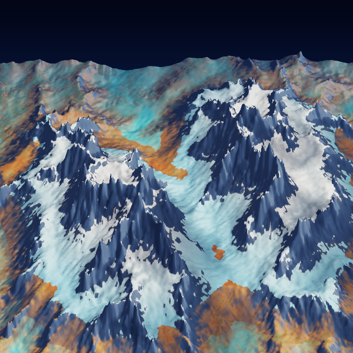 | 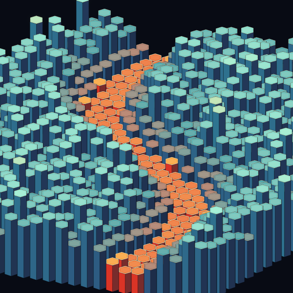 | 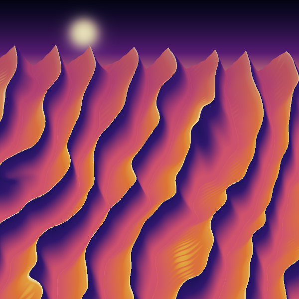 | 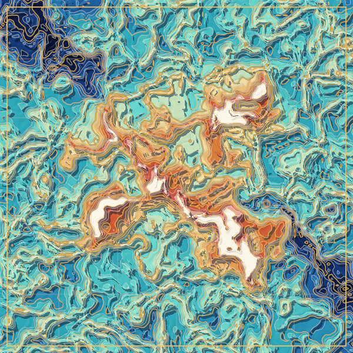 |
| **[Wireframe Terrain](./gallery.md#wireframe-terrain)** | **[Riemann Zeta](./gallery.md#riemann-zeta)** | **[Hopf Fibration](./gallery.md#hopf-fibration)** | **[Thomas Attractor](./gallery.md#thomas-attractor)** |
| 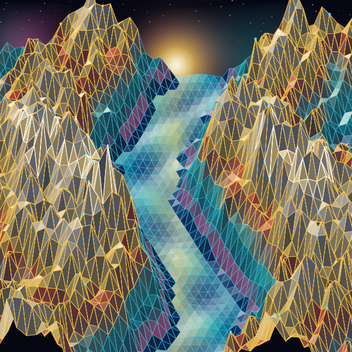 | 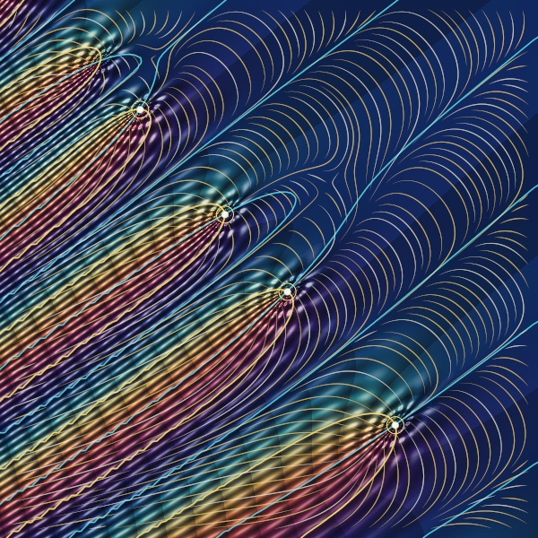 | 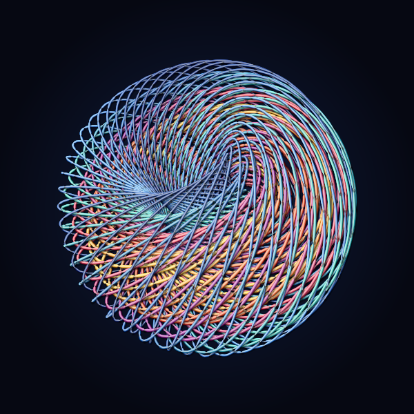 | 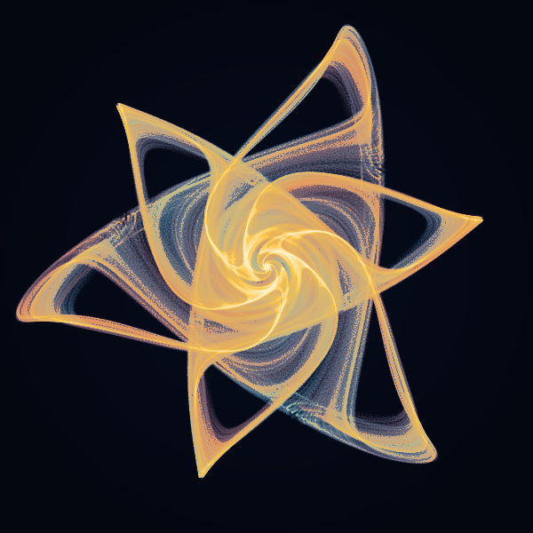 |
| **[Faraday Waves](./gallery.md#faraday-waves)** | **[Möbius Loxodrome](./gallery.md#mobius-loxodrome)** | **[Lagrangian Coherent](./gallery.md#lagrangian-coherent)** | **[Hyperbolic Fuchsian](./gallery.md#hyperbolic-fuchsian)** |
| 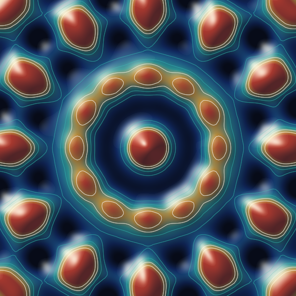 | 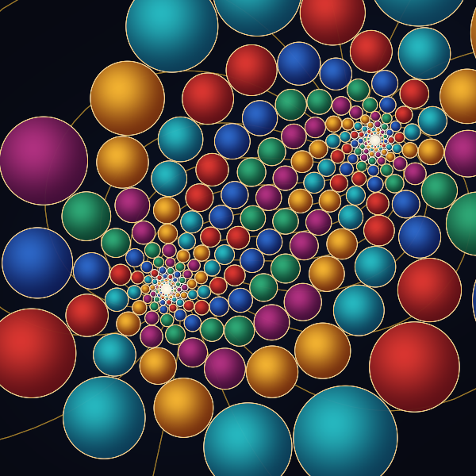 | 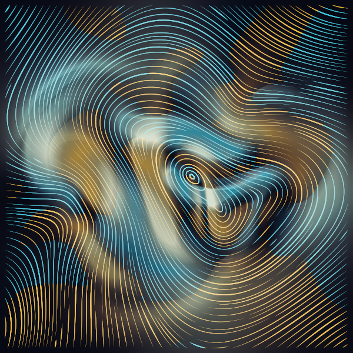 | 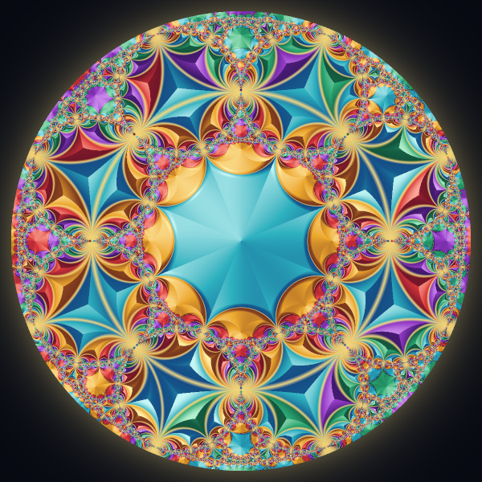 |

👉 **[View All 111 Artworks & Code Examples in `gallery.md` →](./gallery.md)**

### 🎞️ Seamless 600×600 HD Looping Animations (`DrawTimelapseFrames` + `ToGIF`)

| 3D Lissajous Silk (`lissajousribbon`) | Karst Terraces (`marchingisolines`) | Jovian Vortex (`vortexfluid`) | Dunhuang Caisson (`dunhuangapsara`) |
| :---: | :---: | :---: | :---: |
| 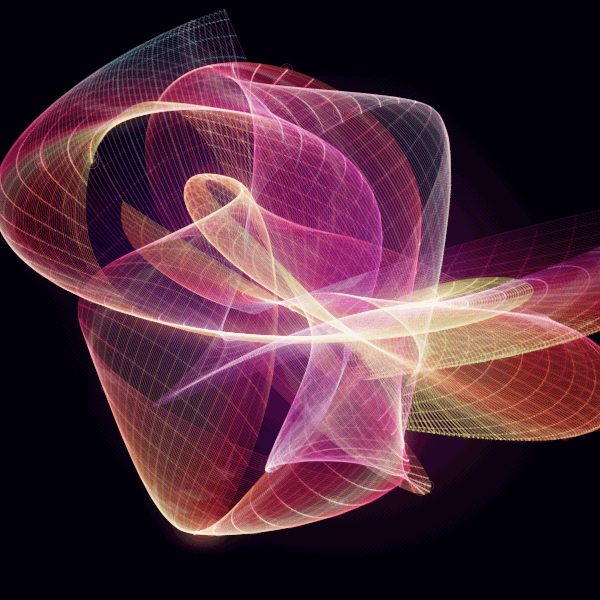 | 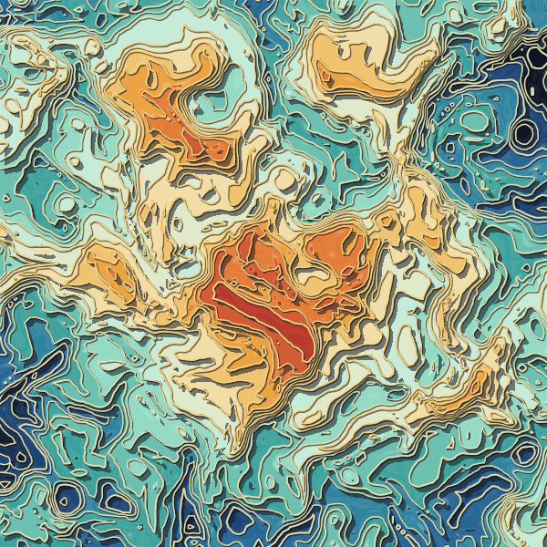 | 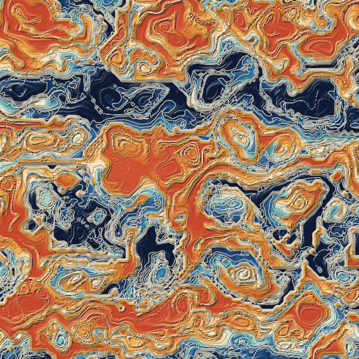 | 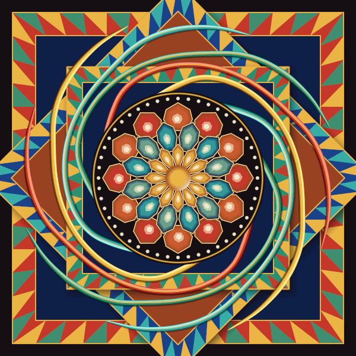 |
| **Gothic Rose Window (`stainedrosewindow`)** | **Newton Fractal Silk (`newtonbasin`)** | **3D Miura-Ori (`origamitessellation`)** | **BZ Spiral Waves (`cyclicautomata`)** |
| 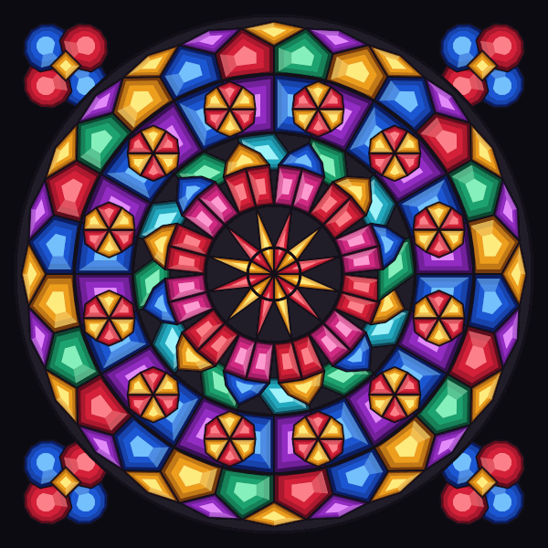 | 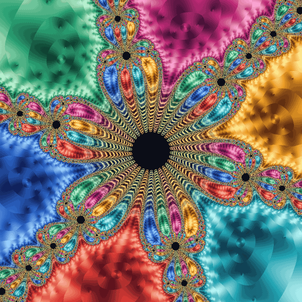 | 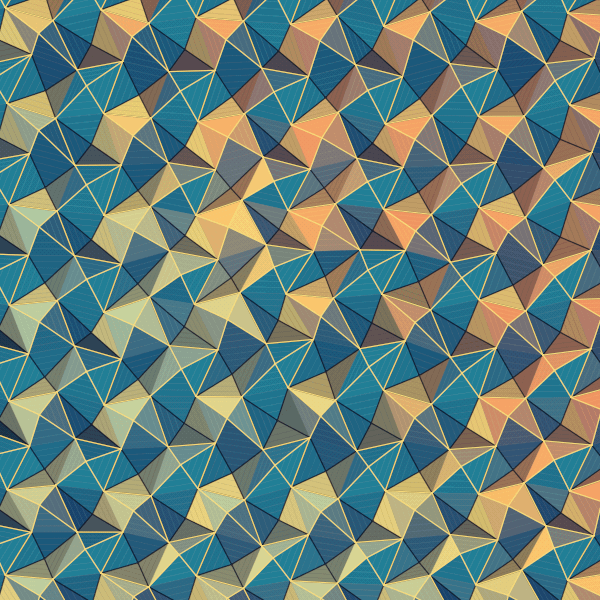 | 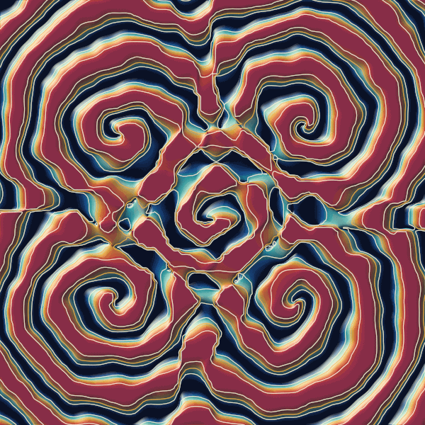 |
| **3D Gyroid TPMS (`gyroidsurface`)** | **Mosaic Sun (`mosaicsun`)** | **Magnetic Dipole (`magneticdipole`)** | |
| 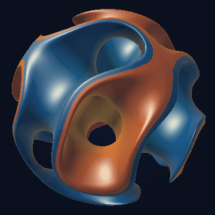 | 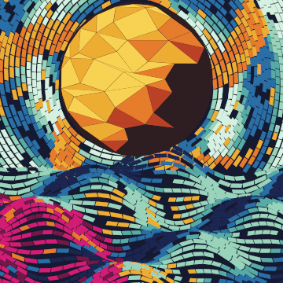 | 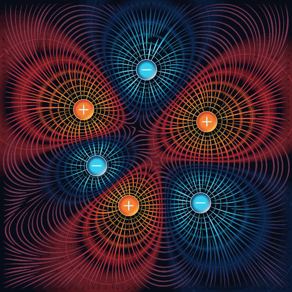 | |

### 🖼️ Museum Exhibition Posters & Multi-Panel Contact Sheets (`genart poster`)

| Curated Multi-Artwork Exhibition (`theme=dark`) | Multi-Seed Variation Study (`theme=light`) |
| :---: | :---: |
| 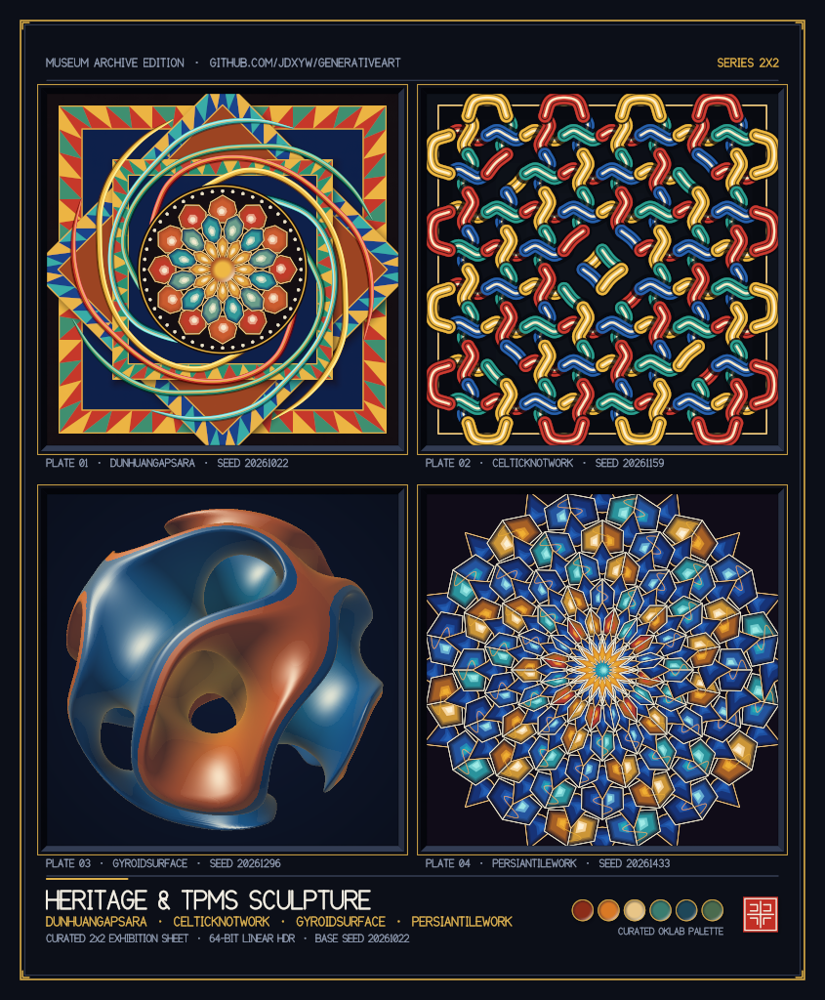 | 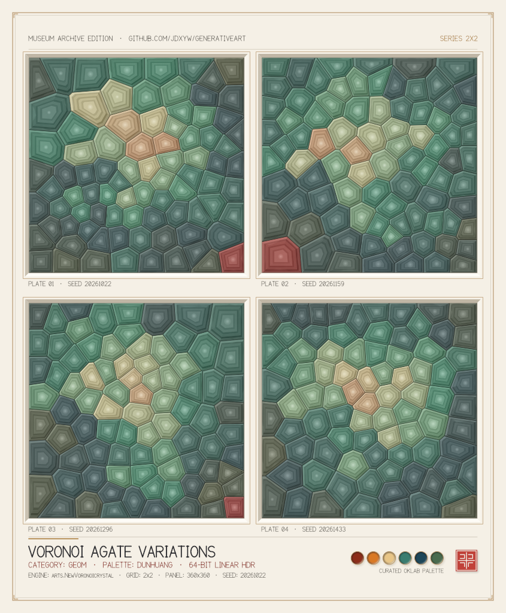 |

---

## Core Engine Capabilities

1. **64-Bit Linear HDR Rendering Engine (`render/`)**:
   - Floating-point linear-RGB accumulation buffer (`render.Canvas`) with `O(1)` 256-entry sRGB lookup (`SRGB8ToLinear`), 9 Porter-Duff & separable blend modes (`BlendOver`, `BlendAdd`, `BlendMultiply`, `BlendScreen`, `BlendSoftLight`, etc.), ACES filmic tone mapping, and multi-core row parallelization (`parallelRows`).
2. **Perceptual Color & Multi-Dimensional Noise (`common/`)**:
   - Exact Oklab, CIE-L\*C\*h° (HCL), and CIELAB interpolation (`MultiStopGradient` with pre-cached stops), Inigo Quilez cosine palettes, 12+ curated palettes (`Cyberpunk`, `Dunhuang`, `UkiyoE`, `Inferno`, `Oceanic`, `Sunset`, `Botanical`, etc.), and seeded 2D/3D/4D Simplex, Ridged multifractal, Worley cellular, and seamless periodic `FBM4DLoop` / `Curl4DLoop` fields.
3. **Computational Geometry, Flow Fields & 2D SDFs (`render/field_engine.go`, `render/sdf2d.go`)**:
   - Jobard-Lefer RK4 evenly-spaced streamline integrator (`TraceEvenStreamlines`), sub-pixel stitched Marching Squares contour extractor (`ExtractMarchingSquares`), analytical 2D Signed Distance Fields (`SDFCircle`, `SDFBox`, `SDFPolygon`, `SDFSmoothUnion`), soft drop shadows (`RenderSDFDropShadow`), and 3D beveled enamel/glass primitives (`DrawCloisonneCell`, `DrawStainedGlassCell`, `DrawMosaicBrick`, `FiberGBuffer`).
4. **Dual Vector (`SVG` / `PDF`), Animated `GIF` & Reproducible PNG Recipes (`platform.go`)**:
   - Export any canvas to lossless **PNG** (with embedded `GenerativeArt-Recipe` `tEXt` JSON metadata), infinite-resolution **SVG** (`c.ToSVG`) and **PDF** (`c.ToPDF`), or looping **GIF** animations (`c.DrawTimelapse` + `c.ToGIF`).

---

## Install

### Library

```bash
go get github.com/jdxyw/generativeart
```

### Standalone CLI (`cmd/genart`)

```bash
go install github.com/jdxyw/generativeart/cmd/genart@latest
```

---

## CLI Tool (`cmd/genart`)

The `cmd/genart` command-line tool lets you list available generators/palettes, render artworks to `.png`, `.svg`, `.pdf`, `.gif`, or `.jpg` at custom resolutions and seeds, and inspect embedded PNG recipe metadata.

### 1. List Supported Generators & Palettes

```bash
go run ./cmd/genart list
```

### 2. Render to PNG, Vector SVG/PDF, or Animated GIF

```bash
# Render a 1200x1200 PNG with a deterministic seed (automatically embeds recipe metadata)
go run ./cmd/genart render -art cloisonneenamel -palette dunhuang -w 1200 -h 1200 -seed 20261021 -out cloisonne.png

# Export infinite-resolution Vector SVG or archival PDF
go run ./cmd/genart render -art stainedrosewindow -w 800 -h 800 -out rose.svg
go run ./cmd/genart render -art artdecosunburst -w 800 -h 800 -out artdeco.pdf

# Render a 16-frame 600x600 HD seamless loop GIF animation
go run ./cmd/genart render -art dunhuangapsara -w 600 -h 600 -frames 16 -delay 7 -out images/dunhuangapsara_loop.gif
```

### 3. Render Museum Exhibition Posters & Multi-Seed Contact Sheets (`genart poster`)

`genart poster` composes either a **multi-seed variation study** for a single generator (`-art`) or a **curated multi-engine exhibition sheet** (`-arts`) with 45° beveled passe-partout mat windows, zero-dependency vector engraver typography, 3D Oklab palette swatches, and a vermilion seal:

```bash
# Curated 2x2 Multi-Engine Exhibition Poster (Obsidian Dark & Gold Mat)
go run ./cmd/genart poster \
  -arts dunhuangapsara,celticknotwork,gyroidsurface,persiantilework \
  -grid 2x2 -panel 360 -theme dark \
  -title "HERITAGE & TPMS SCULPTURE" \
  -out images/poster_wave12_dark.png

# 2x2 Multi-Seed Variation Contact Sheet (Museum Ivory Parchment Mat)
go run ./cmd/genart poster \
  -art voronoicrystal \
  -grid 2x2 -panel 360 -theme light \
  -title "VORONOI AGATE VARIATIONS" \
  -out images/poster_voronoi_light.png
```

| Flag | Default | Description |
| :--- | :--- | :--- |
| `-art` | `dunhuangapsara` | Single generator ID for a multi-seed variation contact sheet |
| `-arts` | `""` | Comma-separated generator IDs for a curated multi-engine exhibition poster |
| `-grid` | `2x2` | Grid dimensions `RowsxCols` (e.g. `1x1`, `2x2`, `3x3`) |
| `-panel` | `420` | Square pixel resolution (`WxH`) of each individual artwork panel |
| `-theme` | `light` | Mat theme: `light` (Museum Ivory Parchment) or `dark` (Obsidian Gallery Gold) |
| `-palette` | *(auto)* | Optional palette name override (e.g. `dunhuang`, `cyberpunk`, `ukiyoe`) |
| `-title` | *(auto)* | Custom main exhibition title |
| `-subtitle`| *(auto)* | Custom secondary subtitle |
| `-seed` | `20261022` | Base deterministic random seed (panel $k$ uses `seed + 137*k`) |
| `-out` | `poster.png` | Output path (`.png`, `.svg`, `.pdf`, `.jpg`) |

### 4. Inspect & Replay Embedded PNG Recipe Metadata

Every PNG saved via `c.ToPNG()` or `genart render` embeds a standard PNG `tEXt` chunk (`GenerativeArt-Recipe`) recording the engine name, dimensions, seed, background color, and struct parameters:

```bash
# Inspect the embedded JSON recipe inside any generated PNG
go run ./cmd/genart inspect cloisonne.png

# Replay a saved PNG recipe at 4K resolution or convert it directly to Vector SVG / PDF
go run ./cmd/genart replay cloisonne.png -w 2400 -h 2400 -out cloisonne_4k.png
go run ./cmd/genart replay cloisonne.png -out cloisonne.svg
```

```json
{
  "engine": "cloisonneEnamel",
  "width": 1200,
  "height": 1200,
  "seed": 20261021,
  "background": [18, 14, 22, 255],
  "params": {
    "petals": 12,
    "rings": 6
  }
}
```

---

## Programmatic Usage

### Basic Rendering, Vector SVG/PDF Export & Recipe Inspection

```go
package main

import (
	"fmt"
	"image/color"

	"github.com/jdxyw/generativeart"
	"github.com/jdxyw/generativeart/arts"
	"github.com/jdxyw/generativeart/common"
)

func main() {
	c := generativeart.NewCanva(600, 600)
	c.SetSeed(20261021)
	c.SetBackground(color.RGBA{R: 18, G: 14, B: 22, A: 255})
	c.FillBackground()
	c.SetColorSchema(common.Dunhuang)

	c.Draw(arts.NewCloisonneEnamel(6, 12))

	// Save PNG (with embedded GenerativeArt-Recipe tEXt metadata), Vector SVG, and PDF
	_ = c.ToPNG("cloisonne.png")
	_ = c.ToSVG("cloisonne.svg")
	_ = c.ToPDF("cloisonne.pdf")

	// Read back the embedded recipe from the saved PNG
	recipe, _ := generativeart.ReadPNGRecipe("cloisonne.png")
	fmt.Printf("Engine=%s Seed=%d Params=%v\n", recipe.Engine, recipe.Seed, recipe.Params)
}
```

### Seamless Loop Animation (`DrawTimelapse` + `ToGIF`)

```go
anim := generativeart.NewAnimatedEngine(func(c *generativeart.Canva, frameIdx, totalFrames int, phase float64) {
	rc := c.NewRenderCanvas()
	ne := c.Noise()
	// Sample 4D curl noise along a closed periodic loop for phase in [0, 1)
	v := ne.Curl4DLoop(2.0, 2.0, phase, 1.2, 1e-3)
	rc.DrawGlowDot(300+v.X*40, 300+v.Y*40, 24, common.Tomato, 0.9, 0.5)
	c.MergeRenderCanvas(rc)
})

c.DrawTimelapseFrames(anim, 24)
_ = c.ToGIF("loop.gif", 6)
```

### Museum Exhibition Poster & Contact Sheet (`RenderPoster` / `ToPosterPNG`)

```go
cfg := generativeart.DefaultPosterConfig()
cfg.Rows, cfg.Cols = 2, 2
cfg.PanelSize = 360
cfg.DarkTheme = true
cfg.Title = "DUNHUANG CAISSON STUDY"
cfg.Palette = common.Dunhuang

poster := generativeart.RenderPoster(arts.NewDunhuangApsara(8, 5), cfg)
_ = poster.ToPNG("poster_dunhuang.png")
```

---

## Supported Art Types & Constructors

All 111 generators implement `generativeart.Engine` under package `github.com/jdxyw/generativeart/arts` (see [gallery.md](./gallery.md) for visual examples and [docs/doc.md](./docs/doc.md) for parameter details):

```go
// Wave 15: Hydraulic Erosion Alpine Peaks, Isometric Basalt Columns, Aeolian Sand Dunes, Bathymetric Trench Chart & 3D Wireframe Glacier Mesh
NewHydraulicErosion(dropletsN int, erosionStrength float64)
NewBasaltColumns(hexRings int, pillarRelief float64)
NewSandDunes(dunesN int, windShear float64)
NewBathymetricChart(isobaths, seamounts int)
NewWireframeTerrain(gridRes int, reliefScale float64)

// Wave 14: Riemann Zeta Critical Strip, 3D Hopf Fibration, Thomas Labyrinth Attractor, 12-Fold Faraday Quasicrystal Waves, Conformal Möbius Loxodrome & FTLE Lagrangian Coherent Structures
NewRiemannZeta(termsN, phaseRays int)
NewHopfFibration(toriN, fibersPerTorus int)
NewThomasAttractor(pointsN int, dampingB float64)
NewFaradayWaves(symmetry int, harmonicScale float64)
NewMobiusLoxodrome(arms, spheresPerArm int)
NewLagrangianCoherent(advSteps int, ftlScale float64)

// Wave 13: 3D Halvorsen Attractor, Kleinian Fuchsian Pearls, Abelian Sandpile, Kuramoto Phase Defects, Farey Ford Circles & Quantum Chaos Scars (100-Art Milestone)
NewHalvorsenAttractor(pointsN int, alpha float64)
NewHyperbolicFuchsian(maxIter int, zoom float64)
NewAbelianSandpile(grains int)
NewKuramotoWave(defectsN, streamlines int)
NewFordCircles(maxDenom int)
NewQuantumBilliard(modesN int, waveNumber float64)

// Wave 12: Dunhuang Caisson, Celtic Knotwork, 3D Gyroid TPMS, Lichtenberg Plasma, Persian Muqarnas & Warring States Bronze
NewDunhuangApsara(ribbons, haloRings int)
NewCelticKnotwork(gridSize int, ribbonWidth float64)
NewGyroidSurface(scaleFreq, thickness float64)
NewLichtenbergTree(branches int, roughness float64)
NewPersianTilework(symmetry, rings int)
NewChampleveEnamel(symmetry, ringCount int)

// Wave 11: Jovian Vortex Fluid, BZ Spiral Waves, Gilded PCB WFC, Cursive Calligraphy, Buddhabrot & Lyapunov
NewVortexFluid(vorticesN, steps int)
NewCyclicAutomata(states, steps int)
NewCircuitWFC(gridSize, busCount int)
NewAsemicCalligraphy(cols, glyphsPerCol int)
NewBuddhabrot(samplesN, maxIter int)
NewLyapunovFractal(seq string, maxIter int)

// Wave 10: 8-Fold Quasicrystals, Sashiko Embroidery, Electromagnetic Dipoles & Complex Newton Fractals
NewAmmannBeenker(depth int)
NewSashikoWeave(gridSize int)
NewMagneticDipole(polesN, linesPerPole int)
NewNewtonBasin(degree, maxIter int)

// Wave 9: Topological Contours, Streamline Engraving, 3D Origami & Bauhaus SDF Relief
NewEvenStreamlines(dSep, dTest float64)
NewMarchingIsolines(levels int, noiseScale float64)
NewOrigamiTessellation(cols, rows int, foldDepth float64)
NewMondrianSubdivision(depth int, pad float64)

// Wave 8: Decorative Arts, Cloisonné Enamel & Printmaking
NewCloisonneEnamel(rings, petals int)
NewWoodblockWave(ridgeLayers, waveLines int)
NewArtDecoSunburst(rayCount, archTiers int)
NewStainedRoseWindow(petals, rings int)

// Wave 7: Anisotropic Flow Mosaic & Low-Poly Crystal Series
NewMosaicVortex(ringSteps int, brickScale float64)
NewMosaicWave(waveCourses int, brickScale float64)
NewMosaicCanyon(strataSteps int, brickScale float64)
NewMosaicLotus(petals int, brickScale float64)
NewMosaicSun(ringSteps int, brickScale float64)

// Wave 6: G-Buffer Impasto, Voxel Terrain & Geometric Replications
NewImpastoFlow(strokeCount, steps int, fieldScale float64)
NewVoxelTerrain(gridRes int, heightScale, contrast float64)
NewPackedCapsules(capsuleCount int, maxScale, minScale float64)
NewOrphicDiscs(discCount int)
NewNautilusSpiral(turns int, chambersPerTurn int)
NewTangentCones(coneCount int)

// Wave 5: Hyperbolic Geometry, Quasicrystals & 3D DoF Chaos
NewPoincareDisk(p, q, depth int)
NewSuminagashi(dropCount, combPasses int, swirlStrength float64)
NewAizawaAttractor(iterations int, dofStrength float64)
NewPenroseTiling(subdivisions int)
NewIsometricCity(gridSize int, density float64)
NewDLAFrost(particleCount int, stickiness float64)

// Wave 1–4: HDR Flow, Strange Attractors, Morphogenesis & Sacred Geometry
NewCurlFlow(lineNum, stepNum int, noiseScale float64)
NewSandRing(ringNum, grainsPerStep int, noiseScale float64)
NewWatercolor(shapeNum, layers, subdivisions int, roughness float64)
NewGuilloche(curveNum int, majorR, minorR, penOffset float64)
NewCliffordNebula(iterations int, a, b, c, d float64)
NewPhysarum(agentNum, steps int, sensorAngle, turnAngle float64)
NewDifferentialGrowth(steps, maxNodes int, minDist, maxDist, repulsionRadius float64)
NewChladni(particleNum int, m, n, a, b float64)
NewVoronoiCrystal(cellNum, relaxSteps int)
NewInkLandscape(layerNum int, roughness float64)
NewGrayScott(steps int, feed, kill float64)
NewLissajousRibbon(curves int, freqX, freqY, freqZ float64)
NewApollonianGasket(maxDepth int, minRadius float64)
NewSpaceColonization(attractorNum, steps int, stepDist, killDist float64)
NewTruchetFlow(baseGrid, maxDepth int)
NewAuroraWave(curtainNum, ribbonSteps int, turbulence float64)
NewFractalFlame(iterations, symmetry int)
NewJoyDivision(lineNum int, amplitude, frequency float64)
NewBoidsFlock(boidNum, steps int, perceptionRadius float64)
NewIslamicStar(gridSize int, contactAngle, strapWidth float64)
NewDelaunayStained(siteNum int, jitter float64)
NewPhyllotaxis(seedCount int, divergenceAngle, scaleFactor float64)

// Classic Sketchbook Generators
NewCircleLine(step float64, lineNum int, radius, xaixs, yaixs float64)
NewCircleLoop(radius float64)
NewMaze(step int)
NewRandCicle(mc, msp int, minStep, maxStep, minr, maxr float64, isRandColor bool)
NewSilkSky(circleNum int, sunRadius float64)
NewSilkSmoke(mc, msp int, minStep, maxStep, minRadius, maxRadius float64, isRandColor bool)
NewSpiralSquare(squareNum int, rectSide, decay float64, randColor bool)
NewSwirl(a, b, c, d, xaixs, yaixs float64)
NewDotLine(n int, ras, canv float64, randColor bool)
NewPointRibbon(r float64)
NewJanus(n int, decay float64)
NewRandomShape(shapeNum int)
NewColorCircle(circleNum int)
NewColorCircle2(circleNum int)
NewCircleGrid(circleNumMin, circleNumMax int)
NewContourLine(lineNum int)
NewNoiseLine(n int)
NewCircleLoop2(depth int)
NewPixelHole(dotN int)
NewDotsWave(dotsN int)
NewCircleMove(circleNum int)
NewCircleNoise(dotsN, colorMin, colorMax int)
NewYarn(n int)
NewBlackHole(circleN int, density, circleGap float64)
NewColorCanve(seg float64)
NewDomainWrap(scale, scale2, xOffset, yOffset float64, cmap ColorMapping)
NewPerlinPerls(circleN, dotsN, colorMin, colorMax int)
NewOceanFish(fishN, seg int)
NewJulia(fn EvalFunc, maxz float64, x, y float64)
```

---

## Contributing & Acknowledgements

Contributions, issues, and PRs are welcome! Please see [CONTRIBUTING.md](./CONTRIBUTING.md) and the full architectural roadmap in [docs/roadmap.md](./docs/roadmap.md). If you find this package useful, you can also support it via [PayPal](https://www.paypal.me/jdxyw).

Inspired by works and articles from:
- <https://inconvergent.net/>
- <https://fronkonstin.com/>
- <https://www.iquilezles.org/www/articles/warp/warp.htm>
- <https://github.com/aschinchon/cyclic-cellular-automata>
- <https://github.com/armdz/ProcessingSketchs>
- <https://github.com/Mr-Slesser/Generative-Art-And-Fractals>
- <https://github.com/cdr6934/Generative-Processing-Experiments>
- <https://github.com/pkd2512/inktober2017>
- <http://paulbourke.net/fractals/peterdejong/>
