# Table of Contents

- [CLI Tool (`cmd/genart`) & Exhibition Poster Reference](#cli-tool-cmdgenart--exhibition-poster-reference)
	- [`genart list`](#1-genart-list)
	- [`genart render`](#2-genart-render)
	- [`genart poster`](#3-genart-poster)
	- [`genart inspect` & `genart replay`](#4-genart-inspect--genart-replay)
- [Table of Contents](#table-of-contents)
	- [Color Circle 2](#color-circle-2)
		- [parameters](#parameters)
	- [Dot Line](#dot-line)
		- [parameters](#parameters-1)
	- [Random Shape](#random-shape)
		- [parameters](#parameters-2)
	- [Janus](#janus)
		- [TODO](#todo)
		- [parameters](#parameters-3)
	- [Contour Line](#contour-line)
		- [parameters](#parameters-4)
	- [Silk Sky](#silk-sky)
		- [parameters](#parameters-5)
	- [Julia](#julia)
		- [parameters](#parameters-6)
	- [Noise Line](#noise-line)
		- [parameters](#parameters-7)
	- [Ocean Fish](#ocean-fish)
		- [parameters](#parameters-8)
	- [Circle Loop2](#circle-loop2)
		- [parameters](#parameters-9)
	- [Pixel Hole](#pixel-hole)
		- [parameters](#parameters-10)
	- [Dots Wave](#dots-wave)
		- [parameters](#parameters-11)
	- [Circle Move](#circle-move)
		- [parameters](#parameters-12)
	- [Circle Noise](#circle-noise)
		- [parameters](#parameters-13)
	- [Yarn](#yarn)
		- [parameters](#parameters-14)
	- [Black Hole](#black-hole)
		- [parameters](#parameters-15)
	- [Color Canva](#color-canva)
		- [parameters](#parameters-16)
	- [Domain Warping](#domain-warping)
		- [parameters](#parameters-17)
	- [Perlin Perls](#perlin-perls)
		- [parameters](#parameters-18)
	- [Curl Flow](#curl-flow)
		- [parameters](#parameters-19)
	- [Sand Ring](#sand-ring)
		- [parameters](#parameters-20)
	- [Watercolor](#watercolor)
		- [parameters](#parameters-21)
	- [Guilloche](#guilloche)
		- [parameters](#parameters-22)
	- [Clifford Nebula](#clifford-nebula)
		- [parameters](#parameters-23)
	- [Physarum](#physarum)
		- [parameters](#parameters-24)
	- [Differential Growth](#differential-growth)
		- [parameters](#parameters-25)
	- [Chladni](#chladni)
		- [parameters](#parameters-26)
	- [Voronoi Crystal](#voronoi-crystal)
		- [parameters](#parameters-27)
	- [Ink Landscape](#ink-landscape)
		- [parameters](#parameters-28)
	- [Gray Scott](#gray-scott)
		- [parameters](#parameters-29)
	- [Lissajous Ribbon](#lissajous-ribbon)
		- [parameters](#parameters-30)
	- [Apollonian Gasket](#apollonian-gasket)
		- [parameters](#parameters-31)
	- [Space Colonization](#space-colonization)
		- [parameters](#parameters-32)
	- [Truchet Flow](#truchet-flow)
		- [parameters](#parameters-33)
	- [Aurora Wave](#aurora-wave)
		- [parameters](#parameters-34)
	- [Fractal Flame](#fractal-flame)
		- [parameters](#parameters-35)
	- [Joy Division](#joy-division)
		- [parameters](#parameters-36)
	- [Boids Flock](#boids-flock)
		- [parameters](#parameters-37)
	- [Islamic Star](#islamic-star)
		- [parameters](#parameters-38)
	- [Delaunay Stained](#delaunay-stained)
		- [parameters](#parameters-39)
	- [Phyllotaxis](#phyllotaxis)
		- [parameters](#parameters-40)
	- [Poincare Disk](#poincare-disk)
		- [parameters](#parameters-41)
	- [Suminagashi](#suminagashi)
		- [parameters](#parameters-42)
	- [Aizawa Attractor](#aizawa-attractor)
		- [parameters](#parameters-43)
	- [Penrose Tiling](#penrose-tiling)
		- [parameters](#parameters-44)
	- [Isometric City](#isometric-city)
		- [parameters](#parameters-45)
	- [DLA Frost](#dla-frost)
		- [parameters](#parameters-46)
	- [Impasto Flow](#impasto-flow)
		- [parameters](#parameters-47)
	- [Voxel Terrain](#voxel-terrain)
		- [parameters](#parameters-48)
	- [Packed Capsules](#packed-capsules)
		- [parameters](#parameters-49)
	- [Orphic Discs](#orphic-discs)
		- [parameters](#parameters-50)
	- [Nautilus Spiral](#nautilus-spiral)
		- [parameters](#parameters-51)
	- [Mosaic Sun](#mosaic-sun)
		- [parameters](#parameters-52)
	- [Tangent Cones](#tangent-cones)
		- [parameters](#parameters-53)

## CLI Tool (`cmd/genart`) & Exhibition Poster Reference

The standalone CLI (`cmd/genart`) provides 5 subcommands for listing generators, rendering single works or seamless loop GIFs, composing museum exhibition posters, and inspecting/replaying PNG recipes:

### 1. `genart list`

Lists all 100 registered art generators (with category and default palette) and all 12+ built-in color palettes:

```bash
go run ./cmd/genart list
```

### 2. `genart render`

Renders a single generator to `.png` (with embedded `GenerativeArt-Recipe` `tEXt` metadata), `.svg`, `.pdf`, `.gif`, or `.jpg`:

```bash
go run ./cmd/genart render -art <name> [-palette <name>] [-w 600] [-h 600] [-seed 20261022] [-frames 16] [-delay 7] -out <output.(png|svg|pdf|gif|jpg)>
```

### 3. `genart poster`

Composes a museum-framed `1x1` print, an `RxC` multi-seed variation contact sheet (`-art`), or a curated multi-engine exhibition poster (`-arts`) with 45° beveled mat openings, zero-dependency vector engraver typography, 3D Oklab palette swatches, and a vermilion seal:

```bash
# Curated 2x2 Multi-Engine Exhibition Poster (Obsidian Dark & Gold Mat)
go run ./cmd/genart poster -arts dunhuangapsara,celticknotwork,gyroidsurface,persiantilework -grid 2x2 -panel 360 -theme dark -title "HERITAGE & TPMS SCULPTURE" -out images/poster_wave12_dark.png

# 2x2 Multi-Seed Variation Contact Sheet (Museum Ivory Parchment Mat)
go run ./cmd/genart poster -art voronoicrystal -grid 2x2 -panel 360 -theme light -title "VORONOI AGATE VARIATIONS" -out images/poster_voronoi_light.png
```

- `-art <name>`: Single generator ID for a multi-seed variation study.
- `-arts <a,b,c,d>`: Comma-separated generator IDs for a curated multi-artwork poster.
- `-grid <RxC>`: Grid layout such as `1x1`, `2x2`, or `3x3` (default `2x2`).
- `-panel <px>`: Pixel width and height of each square artwork panel (default `420`).
- `-theme <light|dark>`: `light` (Museum Ivory Parchment) or `dark` (Obsidian Gallery Gold).
- `-palette <name>`: Optional palette override.
- `-title <text>` / `-subtitle <text>`: Custom engraved header/footer text.
- `-seed <int64>`: Base deterministic random seed (default `20261022`).
- `-out <path>`: Output file path (`.png`, `.svg`, `.pdf`, `.jpg`).

### 4. `genart inspect` & `genart replay`

Inspects the `GenerativeArt-Recipe` JSON chunk embedded in any PNG or replays it at any target resolution/vector format:

```bash
go run ./cmd/genart inspect images/dunhuangapsara.png
go run ./cmd/genart replay images/dunhuangapsara.png -w 2400 -h 2400 -out dunhuang_4k.png
```

---

## Color Circle 2

`Color Circle2` is version 2 of `Color Circle`. It still draws the circle and point cloud.

### parameters

- circleNum: The number of the circle in this drawing.

```go
cc := arts.NewColorCircle2(30)
```

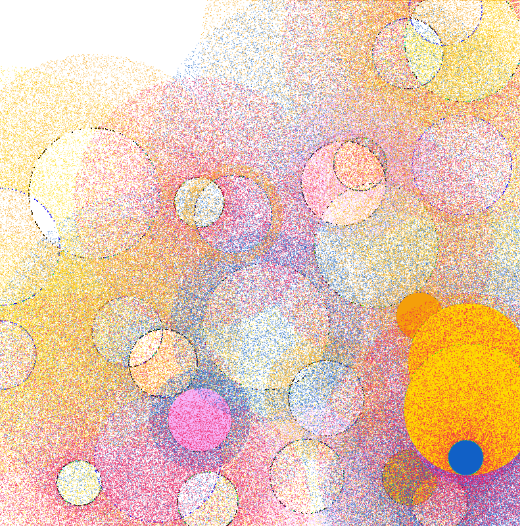

## Dot Line

`dot line` would draw images with the short dot and short. The short lines would compose as a big circle.

### parameters

- n: The number of elements in this image.
- ras/canv: Control the appearance of this image.
- randColor: Use the specified color or random colors.

```go
dl := arts.NewDotLine(100, 20, 50, false)
```

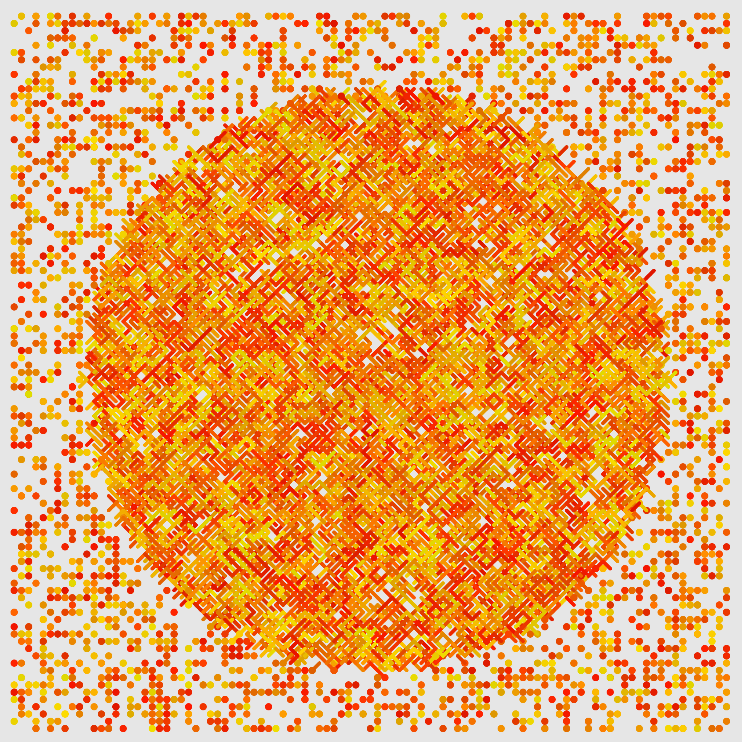

## Random Shape

`random shape` would draw images with random shapes. The whole image would rotate with some degree.

### parameters

- shapeNum: It indicates how many shapes you want to draw.

```go
rs := NewRandomShape(150)
```

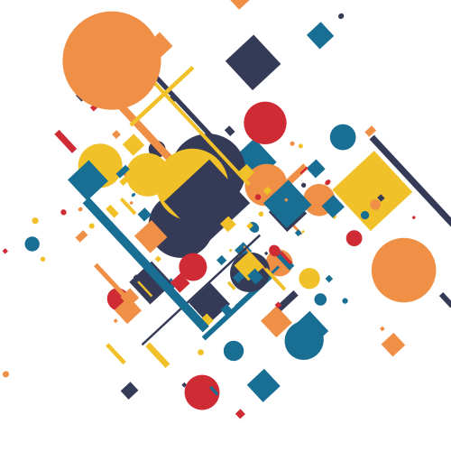

## Janus

`Janus` would draw an image with multiple circles split at its center with random noise in the horizontal direction.

### TODO

### parameters

## Contour Line

`Contour Line` uses the `perlin noise` to do some flow field.

### parameters

- lineNum: It indicates how many lines.

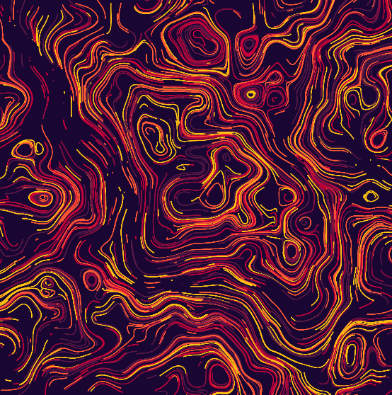

## Silk Sky

`Silk Sky` would draw an image with multiple circles converge to one point or one circle.

### parameters

- circleNum: The number of the circles in this drawing.
- sunRadius: The radius of the sun. The sun is a point/circle where other circles meet.

```go
silkSky := NewSilkSky(circleNum int, sunRadius float64)
```

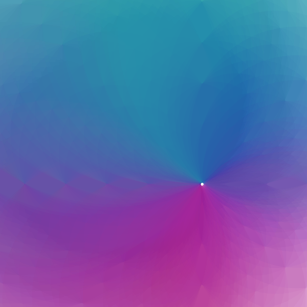

## Julia

`Julia` is to draw a `Julia Set`. [Julia Set](https://en.wikipedia.org/wiki/Julia_set) is a math concept. You can define your own formula in this package.

### parameters

- fn: The custom julia set function.
- maxz: The maximum modulus length of a complex number.
- xaixs, yaixs: The range for the X-Y coordination used to mapping the julia set number to the real pixel of the image. These should be positive. It only indicates the first quadrant range.

```go
func julia1(z complex128) complex128 {
 c := complex(-0.1, 0.651)
 z = z*z + c
 return z
}
julia := arts.NewJulia(julia1, 40, 1.5, 1.5)
```

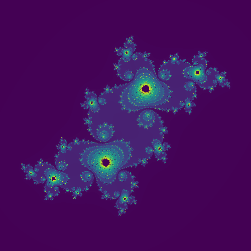

## Noise Line

`Noise Line` draws some random line and circles based on `perlin noise`.

### parameters

- n: The number of random line.

```go
nl := arts.NewNoiseLine(1000)
```

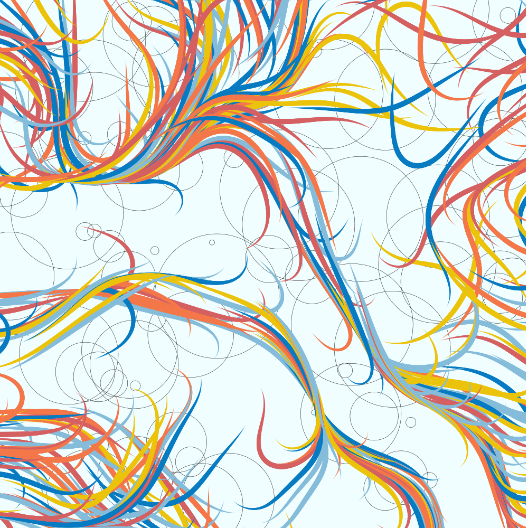

## Ocean Fish

`Ocean Fish` draws an ocean and some fishes in the center.

### parameters

- lineNum: The number of the line used to simulate the ocean wave.
- fishNum: The number of fish.

```go
o := arts.NewOceanFish(100, 8)
```

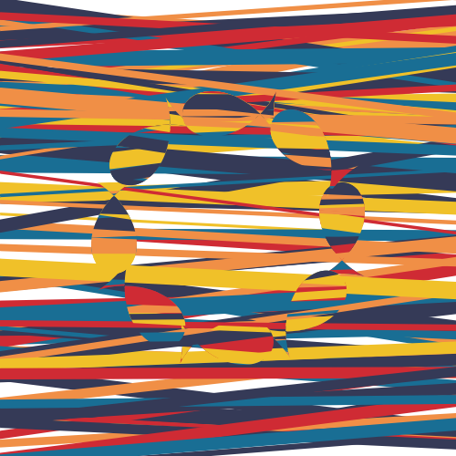

## Circle Loop2

`Circle loop2` draws a circle composed by colored circles.

### parameters

- depth: Control the number of circles.

```go
cl := arts.NewCircleLoop2(7)
```

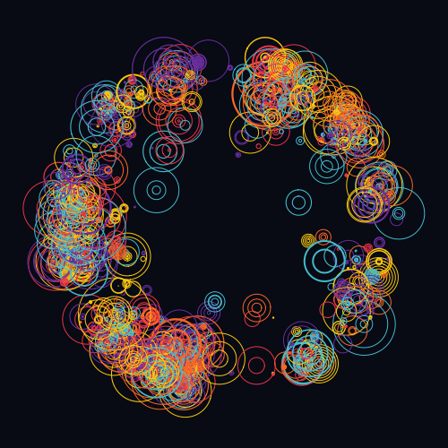

## Pixel Hole

`Pixel Hole` draws a hole with colored dots.

### parameters

- dotN: The number of point in each iteration.

```go
ph := arts.NewPixelHole(60)
```

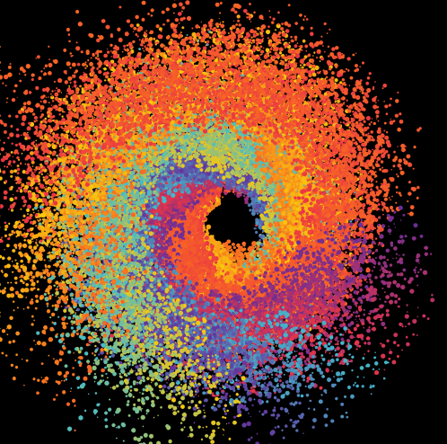

## Dots Wave

### parameters

- dotsN: The number of dots wave in the image.

```go
d := arts.NewDotsWave(300)
```

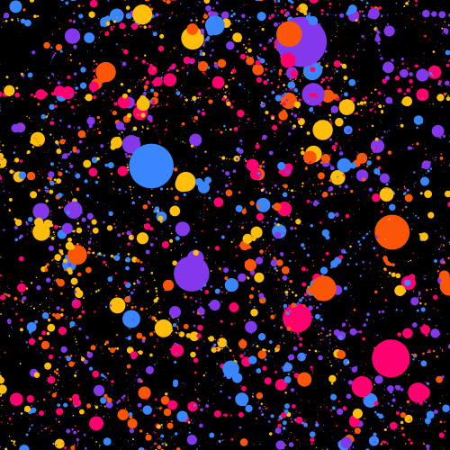

## Circle Move

### parameters

- circleNum: The number of the circle in the image.

```go
cm := arts.NewCircleMove(1000)
```

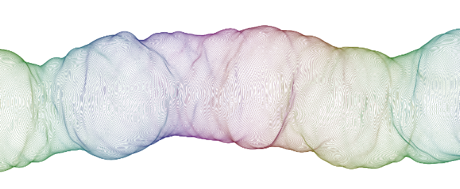

## Circle Noise

### parameters

- dotsN: The number of dot.
- colorMin: The minimum color.
- colorMax: The maximum color.

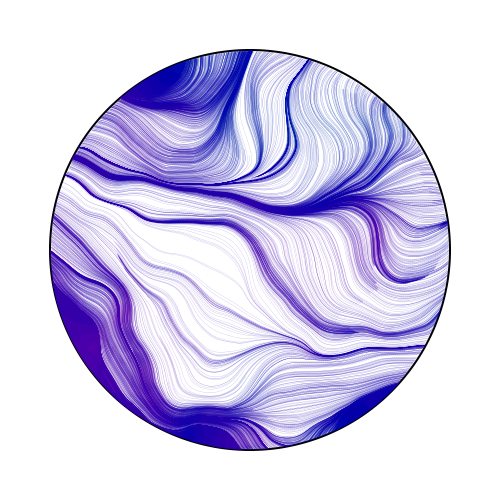

## Yarn

### parameters

- n: The number of the curve.

```go
y := arts.NewYarn(2000)
```

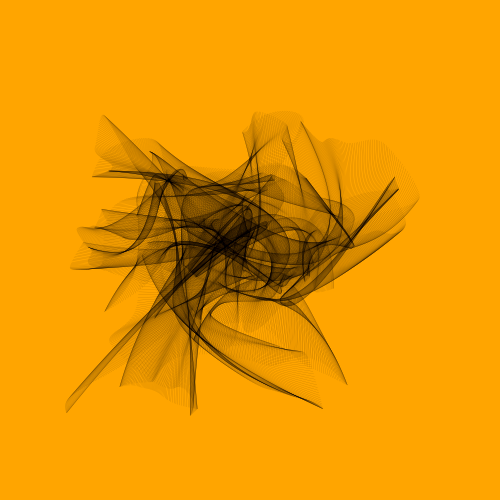

## Black Hole

### parameters

- circleN: The number of the circle.
- density: Control the density of the circle.
- circleGap: Identify the gap between two circles.

```go
b := arts.NewBlackHole(200, 400, 0.01)
```

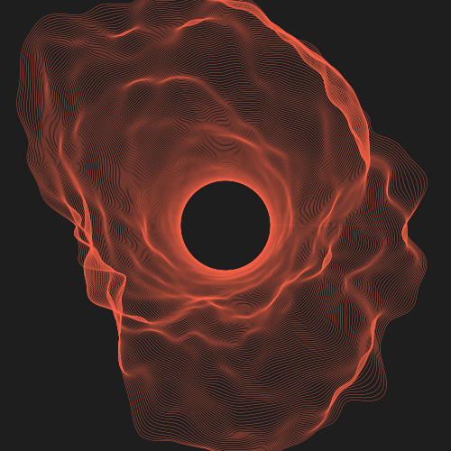

## Color Canva

### parameters

- seg:

```go
cc := arts.NewColorCanve(5)
```

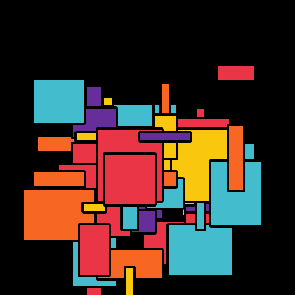

## Domain Warping

Warping, or domain distortion is a very common technique in computer graphics for generating procedural textures and geometry. It's often used to pinch an object, stretch it, twist it, bend it, make it thicker or apply any deformation you want.

### parameters

- scale: Control the noise generator.
- xOffset: Control the noise generator.
- yOffset: Control the noise generator.
- fn: A function to mapping the `noise` to color.

```go
d := arts.NewDomainWrap(0.01, 4, 8, cmap)
```

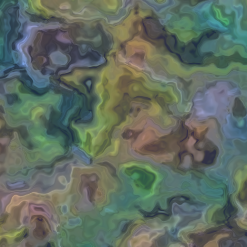

## Perlin Perls

### parameters

- circleN: The number of circle on this image.
- dotsN: The number of dots in each circle. 
- colorMin: The minimum color.
- colorMax: The maximum color.

```go
pp := arts.NewPerlinPerls(10, 200, 40, 80
```

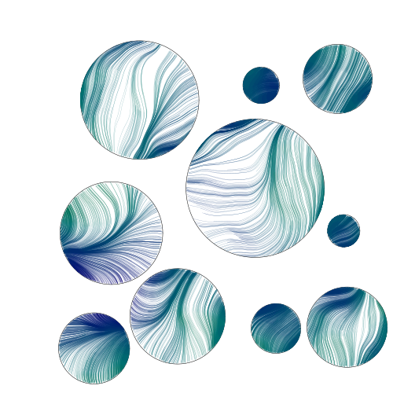

## Curl Flow

`Curl Flow` traces divergence-free curl-noise streamlines across the canvas with smooth organic ribbons and variable stroke widths.

### parameters

- lineNum: The number of streamlines to trace.
- stepNum: The number of integration steps along each streamline.
- noiseScale: The spatial frequency scale of the multi-octave curl noise field.

```go
cf := arts.NewCurlFlow(110, 36, 0.0045)
```

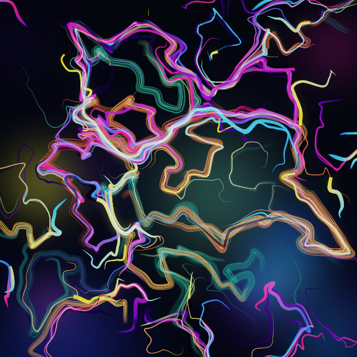

## Sand Ring

`Sand Ring` renders concentric noisy rings using stochastic sand-spline grain deposition and additive luminous blending.

### parameters

- ringNum: The number of concentric deformed rings.
- grainsPerStep: The density of sand grains deposited per interpolation step.
- noiseScale: The amplitude of the radial Perlin noise deformation.

```go
sr := arts.NewSandRing(22, 22, 1.3)
```

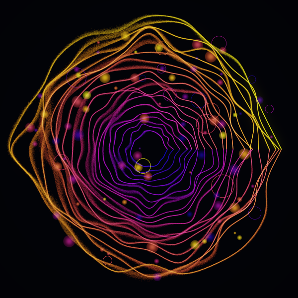

## Watercolor

`Watercolor` simulates organic translucent watercolor washes by recursively subdividing and jittering polygons across multiple pigment layers.

### parameters

- shapeNum: The number of watercolor blotch shapes on the canvas.
- layers: The number of translucent pigment layers stacked per shape.
- subdivisions: The number of recursive edge subdivisions per polygon layer.
- roughness: Controls the edge displacement variance during subdivision.

```go
wc := arts.NewWatercolor(9, 22, 5, 0.32)
```

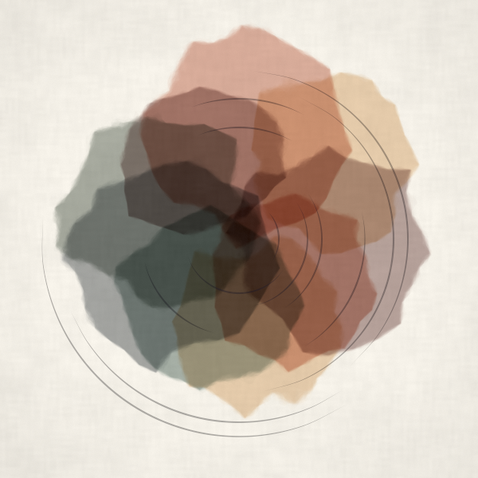

## Guilloche

`Guilloche` generates intricate spirographic hypotrochoid and epitrochoid rosette patterns with phase-shifted harmonic envelopes and luminous interference.

### parameters

- curveNum: The number of phase-shifted guilloche curves in the family.
- majorR: The radius of the fixed outer circle.
- minorR: The radius of the rolling circle.
- penOffset: The distance of the drawing pen from the rolling circle center.

```go
g := arts.NewGuilloche(28, 175, 65, 115)
```

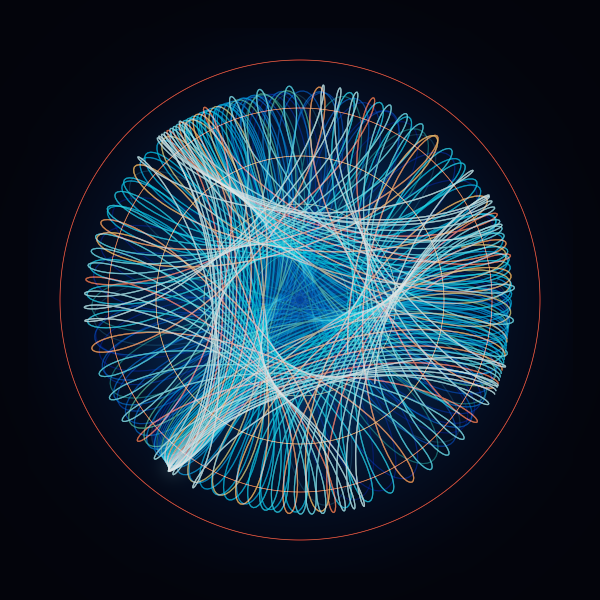

## Clifford Nebula

`Clifford Nebula` renders a strange attractor density cloud (nebula/flam3 histogram rendering) using the Clifford strange attractor equations with log-density tone mapping and velocity-dependent chromaticity.

### parameters

- iterations: The number of strange attractor trajectory steps to accumulate.
- a, b, c, d: The four Clifford attractor control coefficients.

```go
cn := arts.NewCliffordNebula(1500000, -1.7, 1.8, -1.9, -0.4)
```

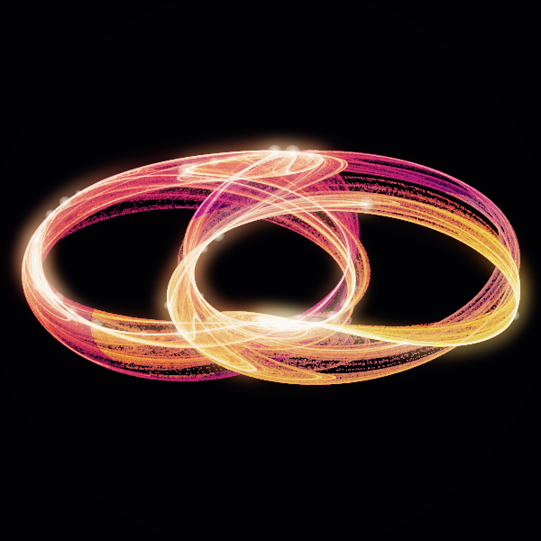

## Physarum

`Physarum` simulates a bioluminescent slime mold transport network with chemotaxis-driven agents, trail deposition, and 3x3 Gaussian diffusion and decay.

### parameters

- agentNum: The number of chemotaxis agents in the simulation.
- steps: The number of simulation steps.
- sensorAngle: The angle offset (in radians) of the left/right chemical sensors.
- turnAngle: The steering angle (in radians) when turning toward higher trail concentrations.

```go
p := arts.NewPhysarum(45000, 110, 0, 0)
```

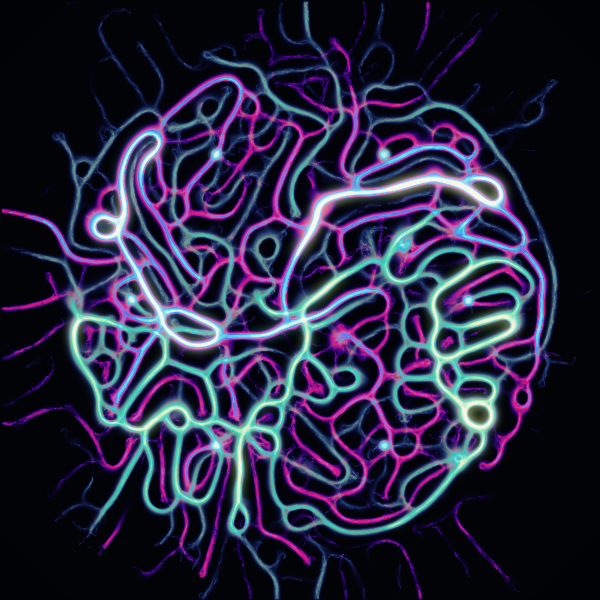

## Differential Growth

`Differential Growth` simulates organic coral and lichen-like folding loops via spring attraction, local repulsion, and dynamic edge subdivision, rendering history trails as luminous strata.

### parameters

- steps: The number of growth simulation iterations.
- maxNodes: The maximum number of vertices allowed in the closed loop.
- minDist: The target equilibrium spring length between adjacent nodes.
- maxDist: The edge length threshold above which a new midpoint node is inserted.
- repulsionRadius: The spatial radius within which non-adjacent nodes repel each other.

```go
dg := arts.NewDifferentialGrowth(220, 1600, 3.5, 7.5, 18.0)
```

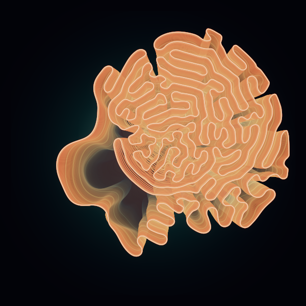

## Chladni

`Chladni` simulates cymatic standing-wave resonance plates where stochastic particles migrate toward zero-amplitude nodal lines of 2D Chladni eigenmodes.

### parameters

- particleNum: The number of acoustic sand particles to simulate.
- m, n: The harmonic mode numbers of the standing wave.
- a, b: The superposition weights of the two orthogonal eigenmodes.

```go
ch := arts.NewChladni(90000, 7, 3, 1.0, -1.0)
```

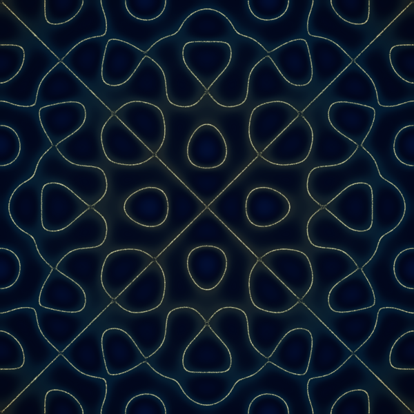

## Voronoi Crystal

`Voronoi Crystal` generates Lloyd-relaxed Voronoi cellular stained-glass crystals with directional facet shading, inner sub-facets, and glowing mineral veins.

### parameters

- cellNum: The number of Voronoi seed sites.
- relaxSteps: The number of Lloyd centroidal relaxation iterations.

```go
vc := arts.NewVoronoiCrystal(85, 4)
```

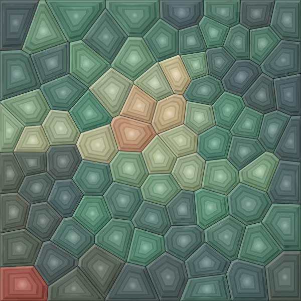

## Ink Landscape

`Ink Landscape` generates traditional East Asian *Shan Shui* ink-wash mountain landscapes with atmospheric fog perspective, FBM ridgelines, vertical *cunfa* texture strokes, and a glowing sun/moon disc.

### parameters

- layerNum: The number of receding mountain ridgeline layers.
- roughness: Controls the fractal Brownian motion terrain relief amplitude.

```go
il := arts.NewInkLandscape(8, 0.45)
```

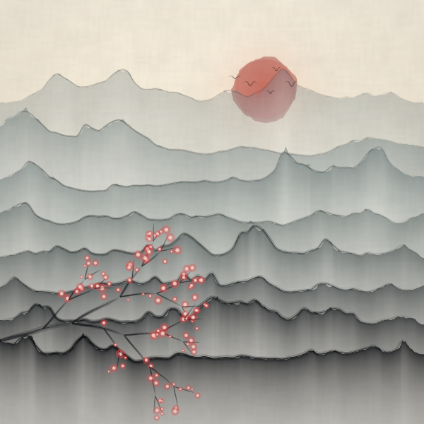

## Gray Scott

`Gray Scott` simulates reaction-diffusion morphogenesis (Turing patterns) on a 2D chemical grid with spatial parameter gradients and 3D normal-mapped specular lighting.

### parameters

- steps: The number of reaction-diffusion PDE integration steps.
- feed: The base chemical feed rate `F`.
- kill: The base chemical kill rate `k`.

```go
gs := arts.NewGrayScott(3200, 0.037, 0.060)
```

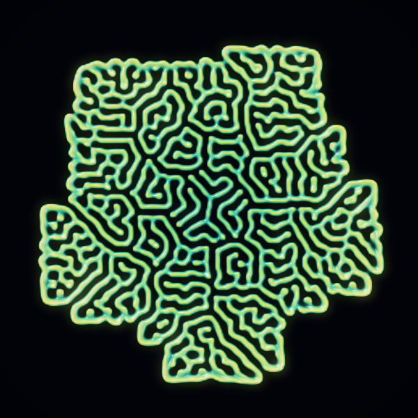

## Lissajous Ribbon

`Lissajous Ribbon` renders 3D phase-evolving harmonic Lissajous silk ribbons with perspective projection, depth-modulated stroke weights, and additive interference glow.

### parameters

- curves: The number of phase-shifted harmonic ribbon layers.
- freqX, freqY, freqZ: The 3D harmonic oscillation frequencies along X, Y, and Z axes.

```go
lr := arts.NewLissajousRibbon(140, 3.0, 4.0, 5.0)
```

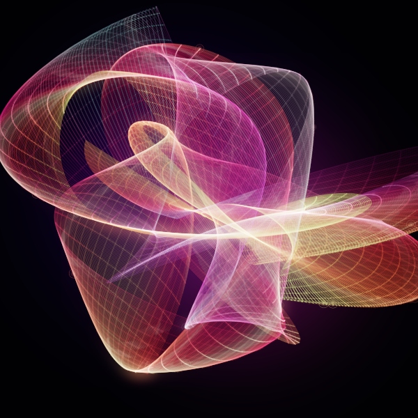

## Apollonian Gasket

`Apollonian Gasket` generates recursive fractal circle packings using Descartes' Circle Theorem and complex Descartes centers with glowing nested rings and jewel-like shading.

### parameters

- maxDepth: The maximum recursion depth for Soddy circle subdivision.
- minRadius: The minimum pixel radius threshold for packed circles.

```go
ag := arts.NewApollonianGasket(7, 2.5)
```

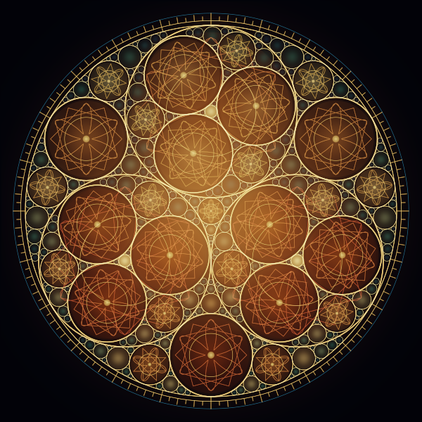

## Space Colonization

`Space Colonization` grows organic bioluminescent mycelial and vascular branching networks toward nutrient attractors, with Strahler-like branch thickness tapering and glowing spore tips.

### parameters

- attractorNum: The number of nutrient attractor points distributed across the canvas.
- steps: The number of network growth iterations.
- stepDist: The branch extension step length per iteration.
- killDist: The attraction radius within which attractors influence growing nodes.

```go
sc := arts.NewSpaceColonization(1800, 160, 6.0, 55.0)
```

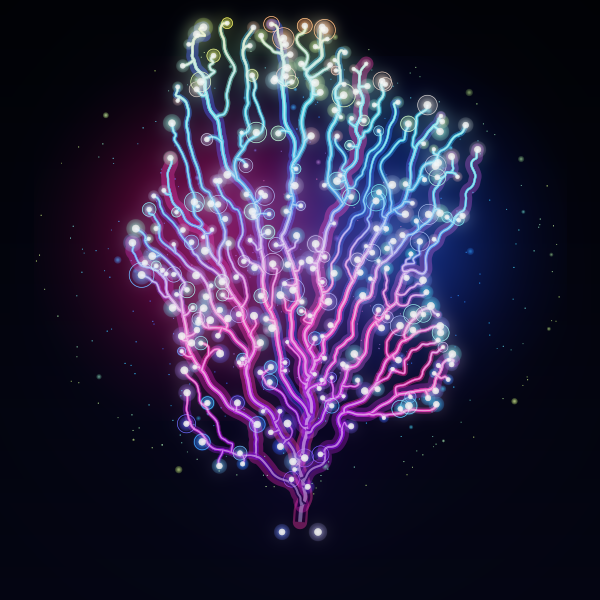

## Truchet Flow

`Truchet Flow` constructs multi-scale quadtree Smith-Truchet quarter-circle tilings with interlocking multi-band ribbons and under/over weave shadows.

### parameters

- baseGrid: The initial coarse grid resolution along each axis.
- maxDepth: The maximum quadtree subdivision depth.

```go
tf := arts.NewTruchetFlow(6, 3)
```

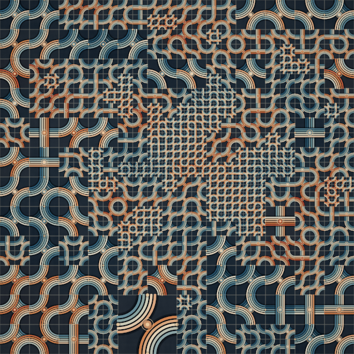

## Aurora Wave

`Aurora Wave` renders boreal geomagnetic light curtains and starfields using FBM-warped vertical ray deposition, altitude-based spectral transitions, and water reflections.

### parameters

- curtainNum: The number of overlapping aurora ribbon curtains.
- ribbonSteps: The horizontal sampling density along each aurora curtain.
- turbulence: Controls the FBM fold amplitude and curtain undulation.

```go
aw := arts.NewAuroraWave(4, 220, 1.0)
```

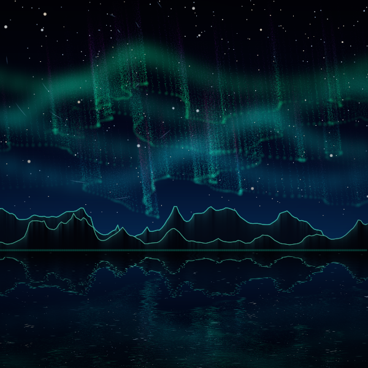

## Fractal Flame

`Fractal Flame` implements Scott Draves' Iterated Function System (IFS) cosmic flame algorithm with non-linear variations (sinusoidal, spherical, swirl, horseshoe, handkerchief), dihedral rotational symmetry, and log-density tone mapping.

### parameters

- iterations: The number of chaos-game IFS trajectory iterations to accumulate.
- symmetry: The dihedral rotational symmetry order.

```go
ff := arts.NewFractalFlame(1800000, 5)
```

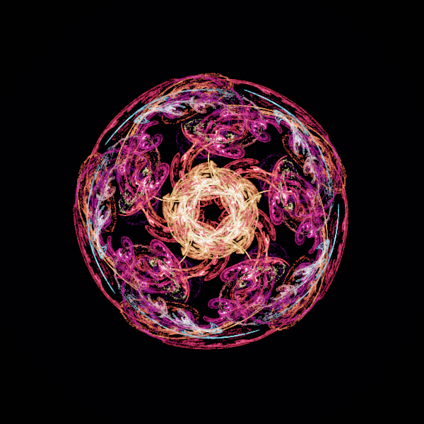

## Joy Division

`Joy Division` renders pulsar elevation ridgelines inspired by CP 1919 (*Unknown Pleasures*) with painter's algorithm horizon occlusion, FBM ridge synthesis, and luminous crest strokes.

### parameters

- lineNum: The number of horizontal pulsar scanlines stacked vertically.
- amplitude: Controls the vertical ridge peak elevation multiplier.
- frequency: Controls the horizontal FBM spatial frequency of the ridges.

```go
jd := arts.NewJoyDivision(72, 1.0, 1.0)
```

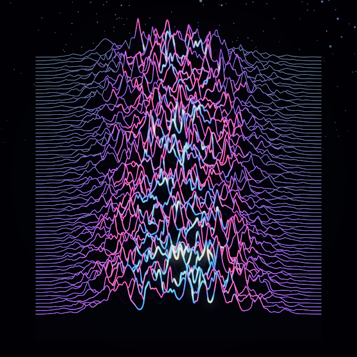

## Boids Flock

`Boids Flock` simulates Craig Reynolds' emergent flocking choreography (separation, alignment, cohesion, and vortex attractors) and renders tapered calligraphic silk ribbon trails with glowing heads.

### parameters

- boidNum: The number of autonomous boid agents in the flock.
- steps: The number of simulation steps recorded along each trajectory.
- perceptionRadius: The neighborhood radius within which boids align, cohere, and separate.

```go
bf := arts.NewBoidsFlock(240, 140, 52.0)
```

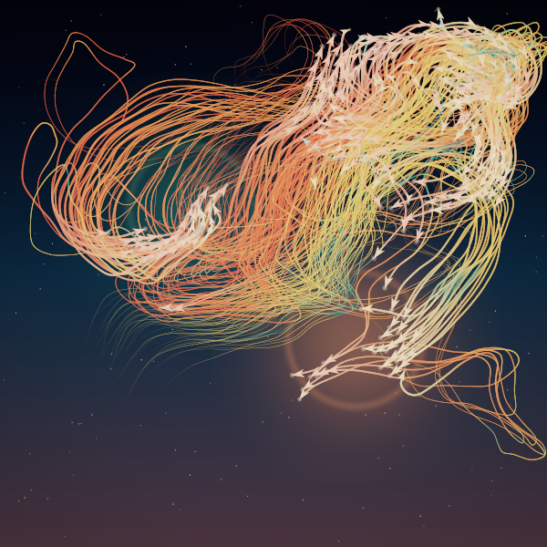

## Islamic Star

`Islamic Star` generates Moroccan *Zellige* and Persian *Girih* rosettes using Hankin's polygons-in-contact method on an octagonal/square tessellation with over-under woven gold-leaf strapwork.

### parameters

- gridSize: The number of tiling cells along each axis of the tessellation.
- contactAngle: The Hankin ray contact angle (in degrees) controlling star point geometry.
- strapWidth: The pixel width of the woven interlacing ribbon straps.

```go
is := arts.NewIslamicStar(4, 67.5, 4.5)
```

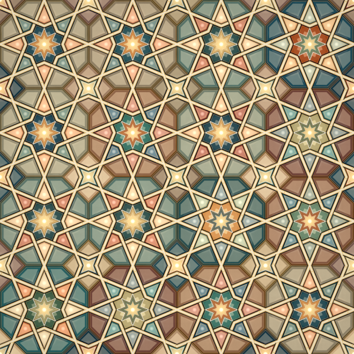

## Delaunay Stained

`Delaunay Stained` constructs a Bowyer-Watson Delaunay triangulation stained-glass mosaic with 3D normal-mapped facet illumination, inner jewel sub-facets, and leaded gold-vein borders.

### parameters

- siteNum: The number of seed vertices in the triangulation.
- jitter: Controls vertex displacement from a stratified radial/grid distribution.

```go
ds := arts.NewDelaunayStained(220, 0.65)
```

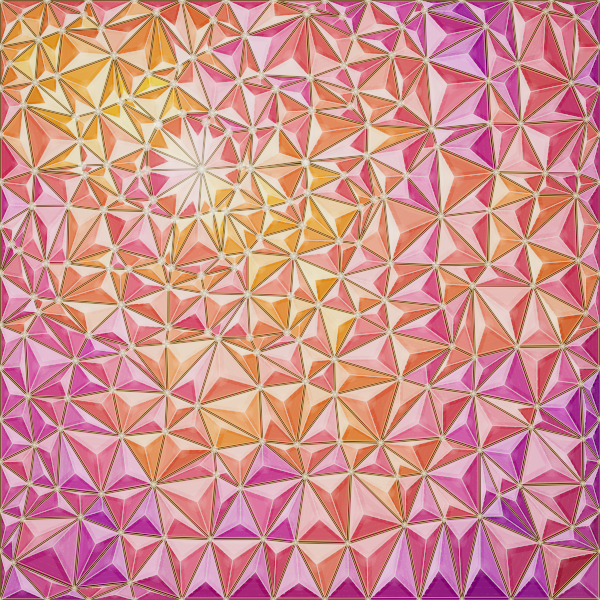

## Phyllotaxis

`Phyllotaxis` generates golden-angle botanical spiral primordia (Vogel's model) with Fibonacci parastichy veins, shaded 3D botanical scales/florets, and bioluminescent pollen highlights.

### parameters

- seedCount: The number of botanical primordia florets arranged along the spiral.
- divergenceAngle: The divergence angle in degrees between successive florets (typically the golden angle `137.50776405`).
- scaleFactor: The radial spacing constant scaling the square-root spiral radius.

```go
pt := arts.NewPhyllotaxis(420, 137.50776405, 11.5)
```

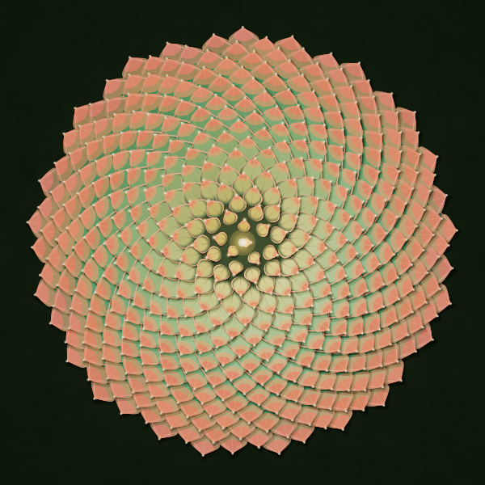

## Poincare Disk

`Poincare Disk` generates Escher-inspired hyperbolic `{p, q}` tessellations inside the Poincaré disk using Möbius gyrovector transformations, geodesic circular arcs, and jewel-like cell shading.

### parameters

- p: The number of sides of each hyperbolic polygon (`(p-2)*(q-2) > 4`).
- q: The number of polygons meeting at each vertex.
- depth: The recursion depth of Möbius edge reflections across geodesic arcs.

```go
pd := arts.NewPoincareDisk(7, 3, 5)
```

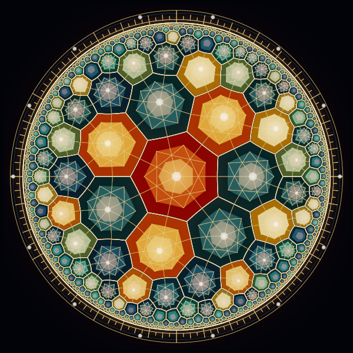

## Suminagashi

`Suminagashi` simulates Japanese floating-ink marbling using area-preserving radial fluid lens deformations, comb-tine rake advection, and curl-noise micro-turbulence on Washi paper.

### parameters

- dropCount: The number of concentric ink drops deposited into the water bath.
- combPasses: The number of directional comb-rake advection passes across the surface.
- swirlStrength: Controls the curl-noise vortex and tine displacement intensity.

```go
sm := arts.NewSuminagashi(48, 7, 1.0)
```

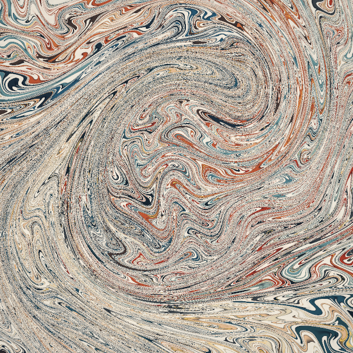

## Aizawa Attractor

`Aizawa Attractor` integrates the 3D Aizawa chaotic strange attractor and projects millions of trajectory samples through a thin-lens camera with Depth-of-Field (DoF) circle-of-confusion bokeh splatting.

### parameters

- iterations: The number of 4th-order Runge-Kutta trajectory steps to accumulate.
- dofStrength: Controls the camera aperture and Depth-of-Field bokeh blur radius.

```go
aa := arts.NewAizawaAttractor(900000, 1.0)
```

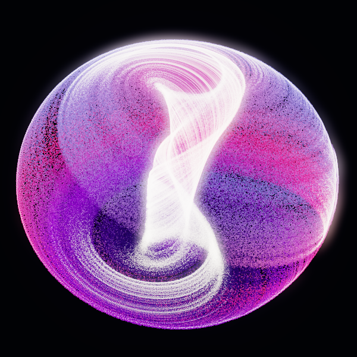

## Penrose Tiling

`Penrose Tiling` constructs 5-fold aperiodic quasicrystal P2/P3 tilings via recursive Robinson golden-triangle deflation, decorated with De Bruijn Ammann bars, shaded facets, and golden vertices.

### parameters

- subdivisions: The number of golden-ratio Robinson triangle deflation generations.

```go
pt := arts.NewPenroseTiling(6)
```

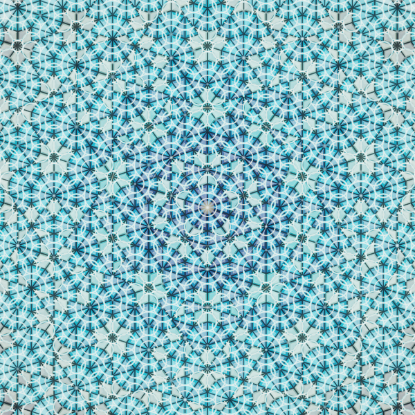

## Isometric City

`Isometric City` generates a *Monument Valley*-inspired 2.5D axonometric architectural citadel with tiered towers, courtyards, arched colonnades, sky-bridges, staircases, and directional sun/shadow illumination.

### parameters

- gridSize: The number of axonometric city blocks along each horizontal axis.
- density: Controls structural height variation, bridge connectivity, and architectural density.

```go
ic := arts.NewIsometricCity(11, 1.0)
```

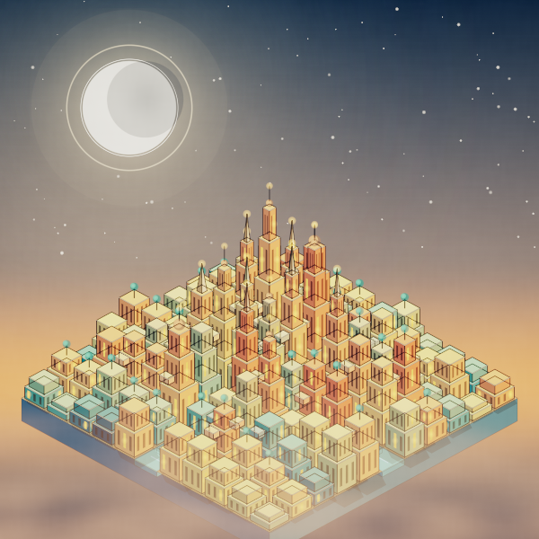

## DLA Frost

`DLA Frost` simulates anisotropic 6-fold Diffusion-Limited Aggregation (DLA) crystal dendrite growth with age-stratified Oklab ice gradients, specular crystal facets, and bioluminescent frost tips.

### parameters

- particleCount: The target number of aggregated crystal particles in the cluster.
- stickiness: Controls the 6-fold hexagonal dendritic anisotropy and sticking probability.

```go
df := arts.NewDLAFrost(18000, 0.55)
```

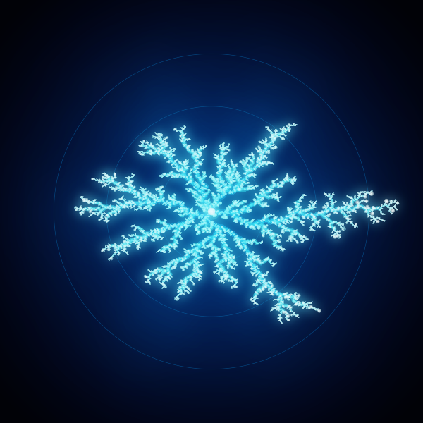

## Impasto Flow

`Impasto Flow` renders multi-vortex fluid dynamics with dense fibrous impasto brushstrokes, 3D specular ridge highlights, and dark ambient troughs.

### parameters

- strokeCount: The number of layered fibrous impasto brush ribbons to trace.
- steps: The number of advection integration steps per stroke.
- fieldScale: Controls the spatial frequency of the curl-noise and vortex velocity field.

```go
iflow := arts.NewImpastoFlow(3200, 520, 0.0032)
```

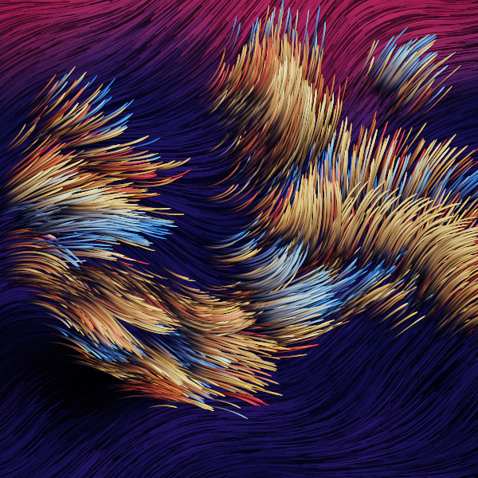

## Voxel Terrain

`Voxel Terrain` generates an isometric micro-voxel stepped topographic canyon with stratified thermal/oceanic contour bands and directional sun-cast shadows.

### parameters

- gridRes: The horizontal resolution of the isometric voxel heightfield grid.
- heightScale: Controls the vertical terrace extrusion multiplier and cliff relief.
- contrast: Controls the shadow depth and top/side facet illumination contrast.

```go
vt := arts.NewVoxelTerrain(340, 2.6, 1.0)
```

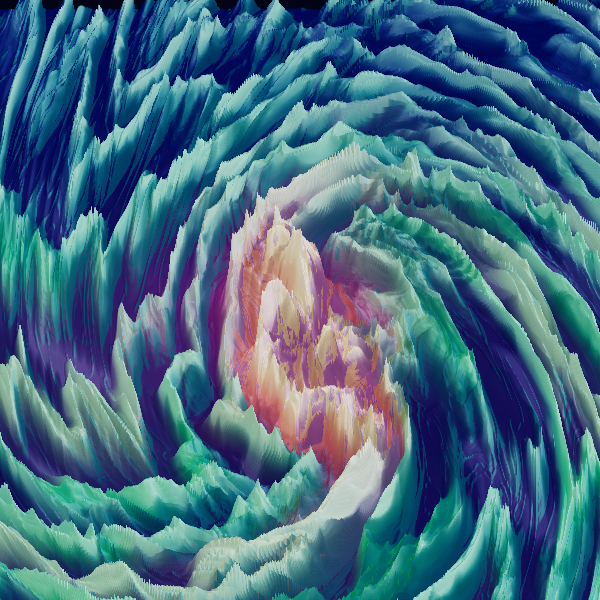

## Packed Capsules

`Packed Capsules` generates a multi-scale collision-free packing of oriented flow-aligned capsules, target rings, and micro-dots with crisp ink outlines and elevation drop shadows.

### parameters

- capsuleCount: The number of candidate capsules and circles to pack into the flow field.
- maxScale: The maximum size multiplier for primary focal capsules.
- minScale: The minimum size multiplier for interstitial micro-capsules and dots.

```go
pc := arts.NewPackedCapsules(2200, 7.2, 3.6)
```

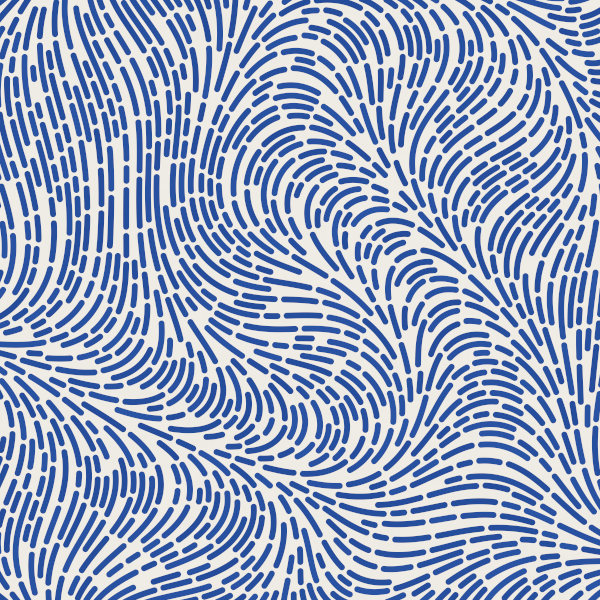

## Orphic Discs

`Orphic Discs` creates Robert & Sonia Delaunay-inspired Orphic Cubism compositions with interlocking eccentric target discs, quadrant chord splits, and stippled gouache paper grain.

### parameters

- discCount: The number of nested eccentric disc assemblies distributed across the canvas.

```go
od := arts.NewOrphicDiscs(34)
```

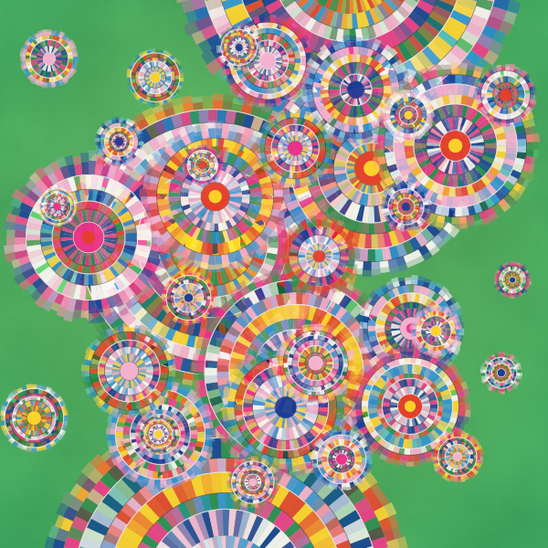

## Nautilus Spiral

`Nautilus Spiral` constructs a golden logarithmic nautilus shell cross-section with curved hydrostatic septa, stippled biomineral chambers, and a warm Voronoi mosaic backdrop.

### parameters

- turns: The number of full logarithmic spiral revolutions.
- chambersPerTurn: The number of subdivided shell chambers per revolution.

```go
ns := arts.NewNautilusSpiral(5, 68)
```


## Mosaic Sun

`Mosaic Sun` renders a stained-glass mosaic solar mandala with radiating alternating warm/cool rays, concentric ring tesserae, and swirling starry sky corona arcs.

### parameters

- ringCount: The number of concentric mosaic tile rings radiating from the solar core.
- rayDensity: Controls the angular subdivision density of the radiating solar beams.

```go
ms := arts.NewMosaicSun(32, 1.0)
```


## Tangent Cones

`Tangent Cones` renders 3D conical relief discs with eccentric apexes, tangent-wrap angular shading, cast drop shadows, and fine radial/concentric engraving rings.

### parameters

- coneCount: The number of non-overlapping and nested 3D conical discs.

```go
tc := arts.NewTangentCones(26)
```


## Mosaic Vortex

`Mosaic Vortex` renders a Starry-Night-inspired swirling sky vortex of anisotropic mosaic tesserae, a low-poly crystal crescent moon, a pinwheel star eye, rolling twilight hills, and a faceted cypress spire.

### parameters

- ringSteps: The number of concentric warped mosaic courses in the primary sky vortex.
- brickScale: Controls the size multiplier of the mosaic bricks and grout insets.

```go
mv := arts.NewMosaicVortex(34, 1.0)
```


## Mosaic Wave

`Mosaic Wave` renders a Ukiyo-e-inspired Great Cresting Wave of flow-aligned mosaic courses, geometric low-poly sea-foam claws, a faceted crimson sun disc, and a snow-capped Mount Fuji peak.

### parameters

- waveCourses: The number of flow-aligned mosaic wave courses from crest to foreground trough.
- brickScale: Controls the size multiplier of the mosaic bricks and grout insets.

```go
mw := arts.NewMosaicWave(32, 1.0)
```


## Mosaic Canyon

`Mosaic Canyon` renders stratified terracotta and ochre canyon cliffs framing a winding turquoise and gold river beneath a blazing low-poly eclipse sun.

### parameters

- strataSteps: The number of geological stratum courses across the canyon walls.
- brickScale: Controls the size multiplier of the mosaic bricks and grout insets.

```go
mc := arts.NewMosaicCanyon(32, 1.0)
```


## Mosaic Lotus

`Mosaic Lotus` renders a monumental low-poly stained-glass lotus mandala over concentric jade-and-turquoise pond ripples, sinuous golden koi flow ribbons, and faceted emerald lily pads.

### parameters

- petals: The number of lotus petals per mandala ring.
- brickScale: Controls the size multiplier of the mosaic bricks and grout insets.

```go
ml := arts.NewMosaicLotus(12, 1.0)
```


## Cloisonne Enamel

`Cloisonne Enamel` renders an Imperial Jingtai-Blue (景泰蓝) cloisonné enamel medallion with double-stroked gilded brass wire filigree, vitreous enamel meniscus shading, auspicious Ruyi cloud scales, and lotus petals.

### parameters

- rings: The number of concentric enamel and Ruyi cloud rings.
- petals: The number of lotus petals per medallion ring.

```go
ce := arts.NewCloisonneEnamel(6, 12)
```


## Woodblock Wave

`Woodblock Wave` renders a polychrome Ukiyo-e woodblock print (锦绘版画) with bokashi ink gradation, carved woodgrain hatch lines, a vermilion sun with drifting clouds, Mount Fuji, a wooden sail ship, and rolling engraved sea swells.

### parameters

- ridgeLayers: The number of foreground wood-engraved wave swell layers.
- waveLines: The total density of carved woodblock engraving lines across the swells.

```go
ww := arts.NewWoodblockWave(5, 42)
```


## Art Deco Sunburst

`Art Deco Sunburst` renders a 1920s Chrysler-and-Metropolis-inspired Art Deco poster with brushed brass sunburst sectors, scalloped arch crowns, bilateral stepped ziggurat skyscrapers, and fountain fans.

### parameters

- rayCount: The number of radiating Art Deco sunburst sectors.
- archTiers: The number of concentric scalloped Chrysler arch tiers around the solar core.

```go
ad := arts.NewArtDecoSunburst(36, 7)
```


## Stained Rose Window

`Stained Rose Window` renders a Chartres-and-Notre-Dame-inspired Gothic Cathedral Rose Window with backlit jewel-toned stained-glass compartments, Gothic pointed-arch lancets, oculus medallions, and heavy lead-came ironwork.

### parameters

- petals: The number of primary radial Gothic lancet sectors.
- rings: The number of concentric stained-glass tracery rings.

```go
sr := arts.NewStainedRoseWindow(12, 5)
```


## Even Streamlines

`Even Streamlines` renders a celestial astrolabe and multi-vortex dipole chart using Jobard-Lefer evenly-spaced streamlines, inverted SDF clip masks, and 3D beveled planetary orbs.

### parameters

- dSep: The minimum seed separation distance between streamlines in pixels.
- dTest: The minimum termination distance during RK4 streamline integration.

```go
es := arts.NewEvenStreamlines(7.5, 3.9)
```


## Marching Isolines

`Marching Isolines` renders stepped Huanglong-inspired karst travertine pools and topographic terraces using Marching Squares contour extraction, 3D elevation drop shadows, and gilded rims.

### parameters

- levels: The number of stepped topographic elevation terraces.
- noiseScale: Controls the spatial frequency of the domain-warped scalar elevation field.

```go
mi := arts.NewMarchingIsolines(16, 1.0)
```


## Origami Tessellation

`Origami Tessellation` renders a 3D Miura-ori and starburst diamond folded paper sculpture with analytical 3D normal Lambertian/Blinn-Phong shading, valley crease ambient occlusion, and gilded mountain ridges.

### parameters

- cols: The number of horizontal origami crease cells.
- rows: The number of vertical origami crease cells.
- foldDepth: Controls the 3D pleat extrusion amplitude.

```go
ot := arts.NewOrigamiTessellation(14, 14, 1.0)
```


## Mondrian Subdivision

`Mondrian Subdivision` renders a Bauhaus / Constructivist 2.5D relief composition using golden-ratio KD-tree subdivision, sub-pixel clip mask stacks, and 2D SDF drop shadows and bevels.

### parameters

- depth: The maximum recursion depth of the golden-ratio KD-tree subdivision.
- pad: The structural frame thickness between adjacent chambers.

```go
ms := arts.NewMondrianSubdivision(4, 6.0)
```


## Ammann Beenker

`Ammann Beenker` renders an 8-fold octagonal Ammann-Beenker aperiodic quasicrystal tessellation of squares and 45-degree star rhombi using De Bruijn's 4-grid dual projection, cloisonné enamel shading, and golden Ammann bars.

### parameters

- depth: Controls the quasicrystal grid density and tile scale.

```go
ab := arts.NewAmmannBeenker(5)
```


## Sashiko Weave

`Sashiko Weave` renders a Japanese Boro indigo textile patchwork quilted with 3D twisted Sashiko running-stitch embroidery (Asanoha hemp leaf, Seigaiha ocean waves, Shippo seven treasures, and Kikko lattices).

### parameters

- gridSize: The number of Boro fabric patches along each axis.

```go
sw := arts.NewSashikoWeave(3)
```


## Magnetic Dipole

`Magnetic Dipole` renders an orthogonal electromagnetic field chart combining Marching Squares equipotential rings, Jobard-Lefer RK4 dipole field lines, and 3D beveled plasma pole cores.

### parameters

- polesN: The number of alternating positive and negative electromagnetic poles.
- linesPerPole: Controls the streamline density around the poles.

```go
md := arts.NewMagneticDipole(6, 28)
```


## Newton Basin

`Newton Basin` renders a complex Newton-Raphson root-finding fractal rosette with 2x2 SSAA, smooth exponential convergence shading, and 3D pleated silk normal lighting.

### parameters

- degree: The polynomial degree $n$ of $P(z) = z^n - 1$.
- maxIter: The maximum number of complex Newton-Raphson iterations per sample.

```go
nb := arts.NewNewtonBasin(6, 48)
```


## Vortex Fluid

`Vortex Fluid` simulates Jovian atmospheric bands and Kármán vortex streets using backward Lagrangian RK4 advection of Rankine vortices, 3D cloud-top relief lighting, and Marching Squares filaments.

### parameters

- vorticesN: The number of counter-rotating Rankine vortices in the atmospheric flow.
- steps: The number of backward RK4 advection steps.

```go
vf := arts.NewVortexFluid(9, 18)
```


## Cyclic Automata

`Cyclic Automata` renders Belousov-Zhabotinsky chemical reaction spiral waves and excitable media phase fields with branch-cut-free complex phasor superposition, 3D Blinn-Phong shading, and Marching Squares contours.

### parameters

- states: The number of quantized excitable media chemical states.
- steps: Controls the spiral wave evolution density.

```go
ca := arts.NewCyclicAutomata(14, 120)
```


## Circuit WFC

`Circuit WFC` synthesizes a gilded silicon wafer and cyberpunk PCB architecture using constraint-propagated octilinear (0/45/90-degree) trace routing, 3D beveled QFP microprocessor dies, and plated through-hole vias.

### parameters

- gridSize: The resolution of the octilinear PCB routing lattice.
- busCount: The number of secondary bus traces routed across the board.

```go
cw := arts.NewCircuitWFC(28, 64)
```


## Asemic Calligraphy

`Asemic Calligraphy` renders an Eastern cursive ink scroll (狂草书法长卷) on ruled Xuan paper with spring-mass brush dynamics, flying-white (Feibai) bristle splits, and vermilion artist seals.

### parameters

- cols: The number of vertical Zhisi-ruled calligraphy columns.
- glyphsPerCol: The number of connected cursive glyphs per column.

```go
ac := arts.NewAsemicCalligraphy(6, 5)
```


## Buddhabrot

`Buddhabrot` renders a 3-channel spectral Nebulabrot probability density cloud using boundary importance sampling, bilateral symmetry, and Oklab false-color HDR tone mapping.

### parameters

- samplesN: The number of candidate complex C trajectories to sample.
- maxIter: The maximum escape iteration threshold.

```go
bb := arts.NewBuddhabrot(450000, 360)
```


## Lyapunov Fractal

`Lyapunov Fractal` renders a Markus-Lyapunov logistic stability exponent landscape with 3D metallic gold and turquoise bevel shading over deep cobalt and crimson chaos regions.

### parameters

- seq: The periodic A/B forcing sequence (e.g., `"AABAB"`).
- maxIter: The number of logistic map iterations per pixel.

```go
lf := arts.NewLyapunovFractal("AABAB", 84)
```


## Dunhuang Apsara

`Dunhuang Apsara` renders a Tang-Dynasty Dunhuang Mogao Cave caisson ceiling (敦煌莫高窟盛唐藻井) with recessed square-diamond coffers, Baoxianghua lotus medallions, pearl chains, and flying celestial silk ribbons.

### parameters

- ribbons: The number of flying celestial silk ribbons swirling around the medallion.
- haloRings: The number of concentric decorative coffer and lotus tiers.

```go
da := arts.NewDunhuangApsara(8, 5)
```


## Celtic Knotwork

`Celtic Knotwork` renders an illuminated Book-of-Kells-inspired interlaced knotwork tapestry with exact alternating over-under strand crossings, umbral occlusion shadows, and gilded borders.

### parameters

- gridSize: The resolution of the interlaced knotwork grid.
- ribbonWidth: Controls the width multiplier of the 4-layer illuminated manuscript ribbons.

```go
ck := arts.NewCelticKnotwork(8, 1.0)
```


## Gyroid Surface

`Gyroid Surface` raymarches a 3D Schoen Gyroid triply periodic minimal surface (TPMS) bounded inside a sculpted sphere with two-sided Oklab iridescence, ambient occlusion, and specular highlights.

### parameters

- scaleFreq: The spatial frequency of the 3D Gyroid lattice.
- thickness: The half-thickness of the minimal surface shell.

```go
gs := arts.NewGyroidSurface(4.2, 0.085)
```


## Lichtenberg Tree

`Lichtenberg Tree` renders a high-voltage dielectric breakdown Lichtenberg lightning figure captured inside a beveled obsidian-sapphire acrylic block with Strahler charge-flux thickness scaling and HDR plasma glow.

### parameters

- branches: The maximum recursion depth of the dielectric breakdown leader tree.
- roughness: Controls the lateral jagged displacement of the lightning channels.

```go
lt := arts.NewLichtenbergTree(9, 1.0)
```


## Persian Tilework

`Persian Tilework` renders an Isfahan-inspired Persian Muqarnas (stalactite vault) dome and Haft-Rangi glazed tile mandala with 16-fold Shamsa starbursts, pointed lancet niches, and golden Islimi arabesques.

### parameters

- symmetry: The rotational symmetry order of the dome (e.g., 16).
- rings: The number of concentric Muqarnas vault tiers.

```go
pt := arts.NewPersianTilework(16, 6)
```


## Champleve Enamel

`Champleve Enamel` renders a Warring States (战国错金银嵌绿松石青铜鉴) gold, silver, and turquoise inlaid bronze mirror with cloud-and-thunder spirals (云雷纹), interlocking dragon scrolls, and cabochon turquoise bosses.

### parameters

- symmetry: The rotational symmetry order of the inlaid scroll bands.
- ringCount: The number of concentric mirror ornament rings.

```go
ce := arts.NewChampleveEnamel(8, 4)
```


## Kintsugi Porcelain

`Kintsugi Porcelain` renders a Song-Dynasty Ru-ware celadon mallow-rimmed porcelain plate (汝窑天青八瓣葵口盘) with Voronoi ice-crackle glaze (冰裂纹开片), incised lotus relief, and 3D 24K gold Kintsugi lacquer seams (金缮描金).

### parameters

- shards: The number of Voronoi ice-crackle ceramic glaze shards across the plate.
- goldVeins: The number of primary 24K gold Kintsugi repair veins radiating from the fracture hubs.

```go
kp := arts.NewKintsugiPorcelain(96, 5)
```


## Water Caustics

`Water Caustics` renders a crystal-clear sunlit turquoise pond with submerged agate river pebbles, swimming koi fish, and refractive optical caustic networks with chromatic dispersion.

### parameters

- stonesN: The number of submerged banded agate pebbles on the pond bed.
- waveAmp: Controls the amplitude of the surface gravity-capillary water waves.

```go
wc := arts.NewWaterCaustics(28, 1.0)
```


## Agate Geode

`Agate Geode` renders a cross-sectioned Brazilian amethyst and fortification agate geode (紫水晶洞与缠丝玛瑙切面) with rhythmic chalcedony mineral bands, gold-leaf veins, and 3D inward-pointing hexagonal quartz crystal prisms.

### parameters

- bandCount: The number of concentric fortification agate mineral rings.
- crystalClusters: The number of inward-pointing 3D hexagonal amethyst crystal spears around the central druzy cavity.

```go
ag := arts.NewAgateGeode(26, 36)
```


## Celestial Armillary

`Celestial Armillary` renders a classical brass equatorial armillary sphere and astrolabe (浑天仪与二十八宿赤道星盘) with 3D tilted ecliptic/horizon rings, toothed clockwork gears, and lunar mansion constellation charts.

### parameters

- rings: The number of concentric declination graticule rings.
- constellations: The number of star constellation graphs plotted across the celestial vault.

```go
ca := arts.NewCelestialArmillary(6, 12)
```


## Soap Iridescence

`Soap Iridescence` renders a Plateau's-law soap foam lattice with physical thin-film optical interference (纳米薄膜干涉牛顿环与皂膜晶格), Marangoni convection swirls, and 3D spherical meniscus highlights.

### parameters

- cells: The target number of soap bubble cells in the foam lattice.
- filmNm: The base soap film thickness in nanometers (controlling the interference spectrum).

```go
si := arts.NewSoapIridescence(42, 480.0)
```


## Malachite Banding

`Malachite Banding` renders a polished Congolese botryoidal malachite and azurite mineral cross-section (孔雀石与蓝铜矿钟乳状同心截面) with smooth-union stalactite nuclei and Kajiya-Kay chatoyant velvet sheen.

### parameters

- nodes: The number of botryoidal stalactite growth nuclei.
- rings: The frequency of the concentric Liesegang malachite growth rings.

```go
mb := arts.NewMalachiteBanding(14, 22)
```


