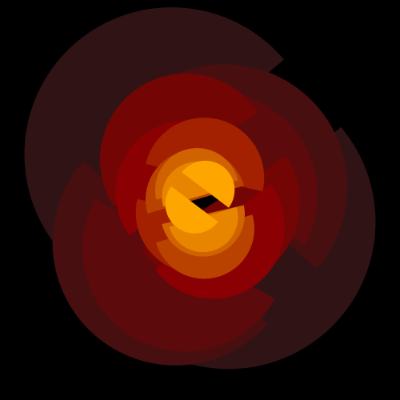
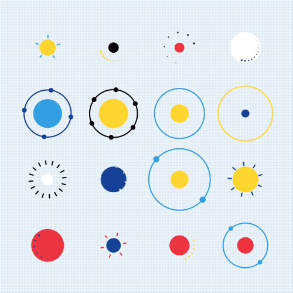
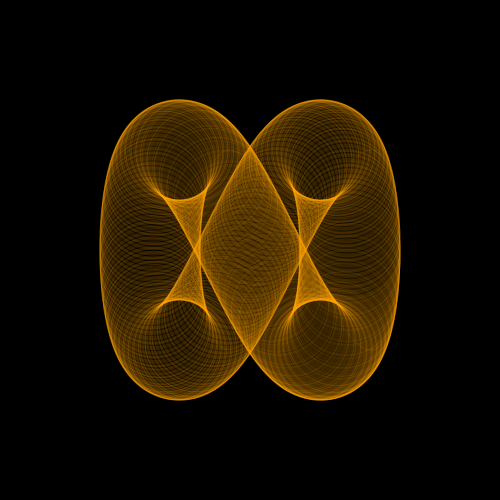
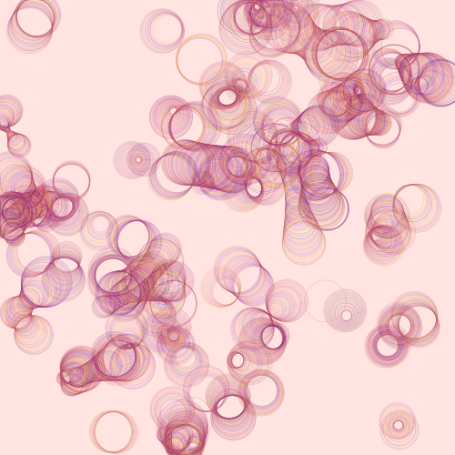

# GenerativeArt Gallery & Code Examples

[← Back to README.md](./README.md) · [🌐 Live Interactive Gallery (GitHub Pages)](https://jdxyw.github.io/generativeart/) · [📚 API & Parameter Docs](./docs/doc.md)

This gallery contains standalone `Go` usage examples and rendered outputs for `generativeart` (newest waves listed first). You can also browse, filter, search, and copy snippets interactively at **[https://jdxyw.github.io/generativeart/](https://jdxyw.github.io/generativeart/)**.

---

## 🎞️ Seamless 600×600 HD Looping GIF Animations (`DrawTimelapseFrames` + `ToGIF`)

| 3D Lissajous Silk (`lissajousribbon`) | Karst Terraces (`marchingisolines`) | Jovian Vortex (`vortexfluid`) | Dunhuang Caisson (`dunhuangapsara`) |
| :---: | :---: | :---: | :---: |
|  |  |  |  |
| **Gothic Rose Window (`stainedrosewindow`)** | **Newton Fractal Silk (`newtonbasin`)** | **3D Miura-Ori (`origamitessellation`)** | **BZ Spiral Waves (`cyclicautomata`)** |
|  |  |  |  |
| **3D Gyroid TPMS (`gyroidsurface`)** | **Mosaic Sun (`mosaicsun`)** | **Magnetic Dipole (`magneticdipole`)** | |
|  |  |  | |

```bash
go run ./cmd/genart render -art lissajousribbon     -w 600 -h 600 -frames 20 -delay 12 -out images/lissajousribbon_loop.gif
go run ./cmd/genart render -art marchingisolines    -w 600 -h 600 -frames 20 -delay 12 -out images/marchingisolines_loop.gif
go run ./cmd/genart render -art vortexfluid         -w 600 -h 600 -frames 20 -delay 12 -out images/vortexfluid_loop.gif
go run ./cmd/genart render -art dunhuangapsara      -w 600 -h 600 -frames 16 -delay 7 -out images/dunhuangapsara_loop.gif
go run ./cmd/genart render -art stainedrosewindow   -w 600 -h 600 -frames 16 -delay 7 -out images/stainedrosewindow_loop.gif
go run ./cmd/genart render -art newtonbasin         -w 600 -h 600 -frames 16 -delay 7 -out images/newtonbasin_loop.gif
go run ./cmd/genart render -art origamitessellation -w 600 -h 600 -frames 16 -delay 7 -out images/origamitessellation_loop.gif
go run ./cmd/genart render -art cyclicautomata      -w 600 -h 600 -frames 16 -delay 7 -out images/cyclicautomata_loop.gif
go run ./cmd/genart render -art gyroidsurface       -w 600 -h 600 -frames 16 -delay 7 -out images/gyroidsurface_loop.gif
go run ./cmd/genart render -art mosaicsun           -w 600 -h 600 -frames 16 -delay 7 -out images/mosaicsun_loop.gif
go run ./cmd/genart render -art magneticdipole      -w 600 -h 600 -frames 16 -delay 7 -out images/magneticdipole_loop.gif
```

---

## 🖼️ Museum Exhibition Posters & Multi-Panel Contact Sheets (`genart poster`)

| Curated Multi-Artwork Exhibition (`theme=dark`) | Multi-Seed Variation Study (`theme=light`) |
| :---: | :---: |
|  |  |

```bash
# Curated 2x2 Multi-Engine Exhibition Poster (Obsidian Dark & Gold Mat)
go run ./cmd/genart poster -arts dunhuangapsara,celticknotwork,gyroidsurface,persiantilework -grid 2x2 -panel 360 -theme dark -title "HERITAGE & TPMS SCULPTURE" -out images/poster_wave12_dark.png

# 2x2 Multi-Seed Variation Contact Sheet (Museum Ivory Parchment Mat)
go run ./cmd/genart poster -art voronoicrystal -grid 2x2 -panel 360 -theme light -title "VORONOI AGATE VARIATIONS" -out images/poster_voronoi_light.png
```

---

## Table of Contents

- [Wave 13: Kintsugi Ru-Ware, Water Caustics, Amethyst Geode, Celestial Armillary, Soap Iridescence & Botryoidal Malachite (100-Art Milestone)](#wave-13-kintsugi-ru-ware-water-caustics-amethyst-geode-celestial-armillary-soap-iridescence--botryoidal-malachite-100-art-milestone)
  - [Kintsugi Porcelain](#kintsugi-porcelain)
  - [Water Caustics](#water-caustics)
  - [Agate Geode](#agate-geode)
  - [Celestial Armillary](#celestial-armillary)
  - [Soap Iridescence](#soap-iridescence)
  - [Malachite Banding](#malachite-banding)
- [Wave 12: Dunhuang Caisson, Celtic Knotwork, 3D Gyroid TPMS, Lichtenberg Plasma, Persian Muqarnas & Warring States Bronze](#wave-12-dunhuang-caisson-celtic-knotwork-3d-gyroid-tpms-lichtenberg-plasma-persian-muqarnas--warring-states-bronze)
  - [Dunhuang Apsara](#dunhuang-apsara)
  - [Celtic Knotwork](#celtic-knotwork)
  - [Gyroid Surface](#gyroid-surface)
  - [Lichtenberg Tree](#lichtenberg-tree)
  - [Persian Tilework](#persian-tilework)
  - [Champleve Enamel](#champleve-enamel)
- [Wave 11: Jovian Vortex Fluid, BZ Spiral Waves, Gilded PCB WFC, Cursive Calligraphy, Buddhabrot & Lyapunov](#wave-11-jovian-vortex-fluid-bz-spiral-waves-gilded-pcb-wfc-cursive-calligraphy-buddhabrot--lyapunov)
  - [Vortex Fluid](#vortex-fluid)
  - [Cyclic Automata](#cyclic-automata)
  - [Circuit WFC](#circuit-wfc)
  - [Asemic Calligraphy](#asemic-calligraphy)
  - [Buddhabrot](#buddhabrot)
  - [Lyapunov Fractal](#lyapunov-fractal)
- [Wave 10: 8-Fold Quasicrystals, Sashiko Embroidery, Electromagnetic Dipoles & Complex Newton Fractals](#wave-10-8-fold-quasicrystals-sashiko-embroidery-electromagnetic-dipoles--complex-newton-fractals)
  - [Ammann Beenker](#ammann-beenker)
  - [Sashiko Weave](#sashiko-weave)
  - [Magnetic Dipole](#magnetic-dipole)
  - [Newton Basin](#newton-basin)
- [Wave 9: Topological Contours, Streamline Engraving, 3D Origami & Bauhaus SDF Relief](#wave-9-topological-contours-streamline-engraving-3d-origami--bauhaus-sdf-relief)
  - [Even Streamlines](#even-streamlines)
  - [Marching Isolines](#marching-isolines)
  - [Origami Tessellation](#origami-tessellation)
  - [Mondrian Subdivision](#mondrian-subdivision)
- [Wave 8: Decorative Arts, Cloisonné Enamel & Printmaking](#wave-8-decorative-arts-cloisonné-enamel--printmaking)
  - [Cloisonne Enamel](#cloisonne-enamel)
  - [Woodblock Wave](#woodblock-wave)
  - [Art Deco Sunburst](#art-deco-sunburst)
  - [Stained Rose Window](#stained-rose-window)
- [Wave 7: Anisotropic Flow Mosaic & Low-Poly Crystal Series](#wave-7-anisotropic-flow-mosaic--low-poly-crystal-series)
  - [Mosaic Vortex](#mosaic-vortex)
  - [Mosaic Wave](#mosaic-wave)
  - [Mosaic Canyon](#mosaic-canyon)
  - [Mosaic Lotus](#mosaic-lotus)
  - [Mosaic Sun](#mosaic-sun)
- [Wave 6: G-Buffer Impasto, Voxel Terrain & Geometric Replications](#wave-6-g-buffer-impasto-voxel-terrain--geometric-replications)
  - [Impasto Flow](#impasto-flow)
  - [Voxel Terrain](#voxel-terrain)
  - [Packed Capsules](#packed-capsules)
  - [Orphic Discs](#orphic-discs)
  - [Nautilus Spiral](#nautilus-spiral)
  - [Tangent Cones](#tangent-cones)
- [Wave 5: Hyperbolic Geometry, Quasicrystals & 3D DoF Chaos](#wave-5-hyperbolic-geometry-quasicrystals--3d-dof-chaos)
  - [Poincare Disk](#poincare-disk)
  - [Suminagashi](#suminagashi)
  - [Aizawa Attractor](#aizawa-attractor)
  - [Penrose Tiling](#penrose-tiling)
  - [Isometric City](#isometric-city)
  - [DLA Frost](#dla-frost)
- [Wave 4: Fractal Flames, Flocking & Sacred Geometry](#wave-4-fractal-flames-flocking--sacred-geometry)
  - [Fractal Flame](#fractal-flame)
  - [Joy Division](#joy-division)
  - [Boids Flock](#boids-flock)
  - [Islamic Star](#islamic-star)
  - [Delaunay Stained](#delaunay-stained)
  - [Phyllotaxis](#phyllotaxis)
- [Wave 3: Reaction-Diffusion, Harmonographs & Venation](#wave-3-reaction-diffusion-harmonographs--venation)
  - [Gray Scott](#gray-scott)
  - [Lissajous Ribbon](#lissajous-ribbon)
  - [Apollonian Gasket](#apollonian-gasket)
  - [Space Colonization](#space-colonization)
  - [Truchet Flow](#truchet-flow)
  - [Aurora Wave](#aurora-wave)
- [Wave 2: Strange Attractors, Slime Molds & Shan-Shui Ink](#wave-2-strange-attractors-slime-molds--shan-shui-ink)
  - [Clifford Nebula](#clifford-nebula)
  - [Physarum](#physarum)
  - [Differential Growth](#differential-growth)
  - [Chladni](#chladni)
  - [Voronoi Crystal](#voronoi-crystal)
  - [Ink Landscape](#ink-landscape)
- [Wave 1: Curl Flow, Sand Painting, Watercolor & Guilloche](#wave-1-curl-flow-sand-painting-watercolor--guilloche)
  - [Curl Flow](#curl-flow)
  - [Sand Ring](#sand-ring)
  - [Watercolor](#watercolor)
  - [Guilloche](#guilloche)
- [Classic Sketchbook Series](#classic-sketchbook-series)
  - [Junas](#junas)
  - [Random Shapes](#random-shapes)
  - [Color Circle2](#color-circle2)
  - [Circle Grid](#circle-grid)
  - [Circle Composes Circle](#circle-composes-circle)
  - [Pixel Hole](#pixel-hole)
  - [Dots Wave](#dots-wave)
  - [Contour Line](#contour-line)
  - [Noise Line](#noise-line)
  - [Dot Line](#dot-line)
  - [Ocean Fish](#ocean-fish)
  - [Circle Loop](#circle-loop)
  - [Domain Warp](#domain-warp)
  - [Circle Noise](#circle-noise)
  - [Perlin Perls](#perlin-perls)
  - [Color Canva](#color-canva)
  - [Julia Set](#julia-set)
  - [Black Hole](#black-hole)
  - [Silk Sky](#silk-sky)
  - [Circle Move](#circle-move)
  - [Random Circle](#random-circle)

---

## Wave 13: Kintsugi Ru-Ware, Water Caustics, Amethyst Geode, Celestial Armillary, Soap Iridescence & Botryoidal Malachite (100-Art Milestone)

### Kintsugi Porcelain

```go
package main

import (
	"image/color"

	"github.com/jdxyw/generativeart"
	"github.com/jdxyw/generativeart/arts"
	"github.com/jdxyw/generativeart/common"
)

func main() {
	c := generativeart.NewCanva(600, 600)
	c.SetSeed(20261023)
	c.SetBackground(color.RGBA{R: 12, G: 14, B: 20, A: 255})
	c.FillBackground()
	c.SetColorSchema(common.Dunhuang)
	c.Draw(arts.NewKintsugiPorcelain(96, 5))
	c.ToPNG("kintsugiporcelain.png")
}
```


### Water Caustics

```go
package main

import (
	"image/color"

	"github.com/jdxyw/generativeart"
	"github.com/jdxyw/generativeart/arts"
	"github.com/jdxyw/generativeart/common"
)

func main() {
	c := generativeart.NewCanva(600, 600)
	c.SetSeed(20261023)
	c.SetBackground(color.RGBA{R: 8, G: 28, B: 44, A: 255})
	c.FillBackground()
	c.SetColorSchema(common.Oceanic)
	c.Draw(arts.NewWaterCaustics(28, 1.0))
	c.ToPNG("watercaustics.png")
}
```


### Agate Geode

```go
package main

import (
	"image/color"

	"github.com/jdxyw/generativeart"
	"github.com/jdxyw/generativeart/arts"
	"github.com/jdxyw/generativeart/common"
)

func main() {
	c := generativeart.NewCanva(600, 600)
	c.SetSeed(20261023)
	c.SetBackground(color.RGBA{R: 12, G: 11, B: 18, A: 255})
	c.FillBackground()
	c.SetColorSchema(common.Cyberpunk)
	c.Draw(arts.NewAgateGeode(26, 36))
	c.ToPNG("agategeode.png")
}
```


### Celestial Armillary

```go
package main

import (
	"image/color"

	"github.com/jdxyw/generativeart"
	"github.com/jdxyw/generativeart/arts"
	"github.com/jdxyw/generativeart/common"
)

func main() {
	c := generativeart.NewCanva(600, 600)
	c.SetSeed(20261023)
	c.SetBackground(color.RGBA{R: 8, G: 12, B: 24, A: 255})
	c.FillBackground()
	c.SetColorSchema(common.Dunhuang)
	c.Draw(arts.NewCelestialArmillary(6, 12))
	c.ToPNG("celestialarmillary.png")
}
```


### Soap Iridescence

```go
package main

import (
	"image/color"

	"github.com/jdxyw/generativeart"
	"github.com/jdxyw/generativeart/arts"
	"github.com/jdxyw/generativeart/common"
)

func main() {
	c := generativeart.NewCanva(600, 600)
	c.SetSeed(20261023)
	c.SetBackground(color.RGBA{R: 6, G: 8, B: 16, A: 255})
	c.FillBackground()
	c.SetColorSchema(common.Cyberpunk)
	c.Draw(arts.NewSoapIridescence(42, 480.0))
	c.ToPNG("soapiridescence.png")
}
```


### Malachite Banding

```go
package main

import (
	"image/color"

	"github.com/jdxyw/generativeart"
	"github.com/jdxyw/generativeart/arts"
	"github.com/jdxyw/generativeart/common"
)

func main() {
	c := generativeart.NewCanva(600, 600)
	c.SetSeed(20261023)
	c.SetBackground(color.RGBA{R: 5, G: 28, B: 18, A: 255})
	c.FillBackground()
	c.SetColorSchema(common.Botanical)
	c.Draw(arts.NewMalachiteBanding(14, 22))
	c.ToPNG("malachitebanding.png")
}
```


---

## Wave 12: Dunhuang Caisson, Celtic Knotwork, 3D Gyroid TPMS, Lichtenberg Plasma, Persian Muqarnas & Warring States Bronze

### Dunhuang Apsara

```go
func main() {
	rand.Seed(time.Now().Unix())
	c := generativeart.NewCanva(600, 600)
	c.SetBackground(color.RGBA{R: 20, G: 14, B: 18, A: 255})
	c.FillBackground()
	c.SetColorSchema(common.Dunhuang)
	c.Draw(arts.NewDunhuangApsara(8, 5))
	c.ToPNG("dunhuangapsara.png")
}
```


### Celtic Knotwork

```go
func main() {
	rand.Seed(time.Now().Unix())
	c := generativeart.NewCanva(600, 600)
	c.SetBackground(color.RGBA{R: 14, G: 18, B: 26, A: 255})
	c.FillBackground()
	c.SetColorSchema(common.Dunhuang)
	c.Draw(arts.NewCelticKnotwork(8, 1.0))
	c.ToPNG("celticknotwork.png")
}
```


### Gyroid Surface

```go
func main() {
	rand.Seed(time.Now().Unix())
	c := generativeart.NewCanva(600, 600)
	c.SetBackground(color.RGBA{R: 10, G: 14, B: 26, A: 255})
	c.FillBackground()
	c.SetColorSchema(common.Dunhuang)
	c.Draw(arts.NewGyroidSurface(4.2, 0.085))
	c.ToPNG("gyroidsurface.png")
}
```


### Lichtenberg Tree

```go
func main() {
	rand.Seed(time.Now().Unix())
	c := generativeart.NewCanva(600, 600)
	c.SetBackground(color.RGBA{R: 6, G: 8, B: 18, A: 255})
	c.FillBackground()
	c.SetColorSchema(common.Cyberpunk)
	c.Draw(arts.NewLichtenbergTree(9, 1.0))
	c.ToPNG("lichtenbergtree.png")
}
```


### Persian Tilework

```go
func main() {
	rand.Seed(time.Now().Unix())
	c := generativeart.NewCanva(600, 600)
	c.SetBackground(color.RGBA{R: 16, G: 12, B: 24, A: 255})
	c.FillBackground()
	c.SetColorSchema(common.Dunhuang)
	c.Draw(arts.NewPersianTilework(16, 6))
	c.ToPNG("persiantilework.png")
}
```


### Champleve Enamel

```go
func main() {
	rand.Seed(time.Now().Unix())
	c := generativeart.NewCanva(600, 600)
	c.SetBackground(color.RGBA{R: 12, G: 14, B: 18, A: 255})
	c.FillBackground()
	c.SetColorSchema(common.Dunhuang)
	c.Draw(arts.NewChampleveEnamel(8, 4))
	c.ToPNG("champleveenamel.png")
}
```


---

## Wave 11: Jovian Vortex Fluid, BZ Spiral Waves, Gilded PCB WFC, Cursive Calligraphy, Buddhabrot & Lyapunov

### Vortex Fluid

```go
func main() {
	rand.Seed(time.Now().Unix())
	c := generativeart.NewCanva(600, 600)
	c.SetBackground(color.RGBA{R: 12, G: 22, B: 46, A: 255})
	c.FillBackground()
	c.SetColorSchema(common.Dunhuang)
	c.Draw(arts.NewVortexFluid(9, 18))
	c.ToPNG("vortexfluid.png")
}
```


### Cyclic Automata

```go
func main() {
	rand.Seed(time.Now().Unix())
	c := generativeart.NewCanva(600, 600)
	c.SetBackground(color.RGBA{R: 10, G: 16, B: 34, A: 255})
	c.FillBackground()
	c.SetColorSchema(common.Sunset)
	c.Draw(arts.NewCyclicAutomata(14, 120))
	c.ToPNG("cyclicautomata.png")
}
```


### Circuit WFC

```go
func main() {
	rand.Seed(time.Now().Unix())
	c := generativeart.NewCanva(600, 600)
	c.SetBackground(color.RGBA{R: 8, G: 20, B: 26, A: 255})
	c.FillBackground()
	c.SetColorSchema(common.Cyberpunk)
	c.Draw(arts.NewCircuitWFC(28, 64))
	c.ToPNG("circuitwfc.png")
}
```


### Asemic Calligraphy

```go
func main() {
	rand.Seed(time.Now().Unix())
	c := generativeart.NewCanva(600, 600)
	c.SetBackground(color.RGBA{R: 244, G: 236, B: 214, A: 255})
	c.FillBackground()
	c.SetColorSchema(common.UkiyoE)
	c.Draw(arts.NewAsemicCalligraphy(6, 5))
	c.ToPNG("asemiccalligraphy.png")
}
```


### Buddhabrot

```go
func main() {
	rand.Seed(time.Now().Unix())
	c := generativeart.NewCanva(600, 600)
	c.SetBackground(color.RGBA{R: 4, G: 6, B: 14, A: 255})
	c.FillBackground()
	c.SetColorSchema(common.Inferno)
	c.Draw(arts.NewBuddhabrot(450000, 360))
	c.ToPNG("buddhabrot.png")
}
```


### Lyapunov Fractal

```go
func main() {
	rand.Seed(time.Now().Unix())
	c := generativeart.NewCanva(600, 600)
	c.SetBackground(color.RGBA{R: 8, G: 12, B: 26, A: 255})
	c.FillBackground()
	c.SetColorSchema(common.Dunhuang)
	c.Draw(arts.NewLyapunovFractal("AABAB", 84))
	c.ToPNG("lyapunovfractal.png")
}
```


---

## Wave 10: 8-Fold Quasicrystals, Sashiko Embroidery, Electromagnetic Dipoles & Complex Newton Fractals

### Ammann Beenker

```go
func main() {
	rand.Seed(time.Now().Unix())
	c := generativeart.NewCanva(600, 600)
	c.SetBackground(color.RGBA{R: 14, G: 14, B: 22, A: 255})
	c.FillBackground()
	c.SetColorSchema(common.Dunhuang)
	c.Draw(arts.NewAmmannBeenker(5))
	c.ToPNG("ammannbeenker.png")
}
```


### Sashiko Weave

```go
func main() {
	rand.Seed(time.Now().Unix())
	c := generativeart.NewCanva(600, 600)
	c.SetBackground(color.RGBA{R: 16, G: 28, B: 58, A: 255})
	c.FillBackground()
	c.SetColorSchema(common.UkiyoE)
	c.Draw(arts.NewSashikoWeave(3))
	c.ToPNG("sashikoweave.png")
}
```


### Magnetic Dipole

```go
func main() {
	rand.Seed(time.Now().Unix())
	c := generativeart.NewCanva(600, 600)
	c.SetBackground(color.RGBA{R: 8, G: 11, B: 22, A: 255})
	c.FillBackground()
	c.SetColorSchema(common.Cyberpunk)
	c.Draw(arts.NewMagneticDipole(6, 28))
	c.ToPNG("magneticdipole.png")
}
```


### Newton Basin

```go
func main() {
	rand.Seed(time.Now().Unix())
	c := generativeart.NewCanva(600, 600)
	c.SetBackground(color.RGBA{R: 10, G: 12, B: 22, A: 255})
	c.FillBackground()
	c.SetColorSchema(common.Dunhuang)
	c.Draw(arts.NewNewtonBasin(6, 48))
	c.ToPNG("newtonbasin.png")
}
```


---

## Wave 9: Topological Contours, Streamline Engraving, 3D Origami & Bauhaus SDF Relief

### Even Streamlines

```go
func main() {
	rand.Seed(time.Now().Unix())
	c := generativeart.NewCanva(600, 600)
	c.SetBackground(color.RGBA{R: 12, G: 16, B: 28, A: 255})
	c.FillBackground()
	c.SetColorSchema(common.Oceanic)
	c.Draw(arts.NewEvenStreamlines(7.5, 3.9))
	c.ToPNG("evenstreamlines.png")
}
```


### Marching Isolines

```go
func main() {
	rand.Seed(time.Now().Unix())
	c := generativeart.NewCanva(600, 600)
	c.SetBackground(color.RGBA{R: 12, G: 22, B: 42, A: 255})
	c.FillBackground()
	c.SetColorSchema(common.Dunhuang)
	c.Draw(arts.NewMarchingIsolines(16, 1.0))
	c.ToPNG("marchingisolines.png")
}
```


### Origami Tessellation

```go
func main() {
	rand.Seed(time.Now().Unix())
	c := generativeart.NewCanva(600, 600)
	c.SetBackground(color.RGBA{R: 16, G: 22, B: 44, A: 255})
	c.FillBackground()
	c.SetColorSchema(common.Dunhuang)
	c.Draw(arts.NewOrigamiTessellation(14, 14, 1.0))
	c.ToPNG("origamitessellation.png")
}
```


### Mondrian Subdivision

```go
func main() {
	rand.Seed(time.Now().Unix())
	c := generativeart.NewCanva(600, 600)
	c.SetBackground(color.RGBA{R: 18, G: 18, B: 24, A: 255})
	c.FillBackground()
	c.SetColorSchema(common.Sunset)
	c.Draw(arts.NewMondrianSubdivision(4, 6.0))
	c.ToPNG("mondriansubdivision.png")
}
```


---

## Wave 8: Decorative Arts, Cloisonné Enamel & Printmaking

### Cloisonne Enamel

```go
func main() {
	rand.Seed(time.Now().Unix())
	c := generativeart.NewCanva(600, 600)
	c.SetBackground(color.RGBA{R: 18, G: 14, B: 22, A: 255})
	c.FillBackground()
	c.SetColorSchema(common.Dunhuang)
	c.Draw(arts.NewCloisonneEnamel(6, 12))
	c.ToPNG("cloisonneenamel.png")
}
```


### Woodblock Wave

```go
func main() {
	rand.Seed(time.Now().Unix())
	c := generativeart.NewCanva(600, 600)
	c.SetBackground(color.RGBA{R: 242, G: 232, B: 206, A: 255})
	c.FillBackground()
	c.SetColorSchema(common.UkiyoE)
	c.Draw(arts.NewWoodblockWave(5, 42))
	c.ToPNG("woodblockwave.png")
}
```


### Art Deco Sunburst

```go
func main() {
	rand.Seed(time.Now().Unix())
	c := generativeart.NewCanva(600, 600)
	c.SetBackground(color.RGBA{R: 14, G: 16, B: 24, A: 255})
	c.FillBackground()
	c.SetColorSchema(common.Sunset)
	c.Draw(arts.NewArtDecoSunburst(36, 7))
	c.ToPNG("artdecosunburst.png")
}
```


### Stained Rose Window

```go
func main() {
	rand.Seed(time.Now().Unix())
	c := generativeart.NewCanva(600, 600)
	c.SetBackground(color.RGBA{R: 12, G: 11, B: 18, A: 255})
	c.FillBackground()
	c.SetColorSchema(common.Cyberpunk)
	c.Draw(arts.NewStainedRoseWindow(12, 5))
	c.ToPNG("stainedrosewindow.png")
}
```


---

## Wave 7: Anisotropic Flow Mosaic & Low-Poly Crystal Series

### Mosaic Vortex

```go
func main() {
	rand.Seed(time.Now().Unix())
	c := generativeart.NewCanva(600, 600)
	c.SetBackground(color.RGBA{R: 16, G: 20, B: 38, A: 255})
	c.FillBackground()
	c.SetColorSchema(common.Oceanic)
	c.Draw(arts.NewMosaicVortex(34, 1.0))
	c.ToPNG("mosaicvortex.png")
}
```


### Mosaic Wave

```go
func main() {
	rand.Seed(time.Now().Unix())
	c := generativeart.NewCanva(600, 600)
	c.SetBackground(color.RGBA{R: 18, G: 24, B: 44, A: 255})
	c.FillBackground()
	c.SetColorSchema(common.UkiyoE)
	c.Draw(arts.NewMosaicWave(32, 1.0))
	c.ToPNG("mosaicwave.png")
}
```


### Mosaic Canyon

```go
func main() {
	rand.Seed(time.Now().Unix())
	c := generativeart.NewCanva(600, 600)
	c.SetBackground(color.RGBA{R: 22, G: 18, B: 32, A: 255})
	c.FillBackground()
	c.SetColorSchema(common.Dunhuang)
	c.Draw(arts.NewMosaicCanyon(32, 1.0))
	c.ToPNG("mosaiccanyon.png")
}
```


### Mosaic Lotus

```go
func main() {
	rand.Seed(time.Now().Unix())
	c := generativeart.NewCanva(600, 600)
	c.SetBackground(color.RGBA{R: 16, G: 24, B: 42, A: 255})
	c.FillBackground()
	c.SetColorSchema(common.Botanical)
	c.Draw(arts.NewMosaicLotus(12, 1.0))
	c.ToPNG("mosaiclotus.png")
}
```


### Mosaic Sun

```go
func main() {
	rand.Seed(time.Now().Unix())
	c := generativeart.NewCanva(600, 600)
	c.SetBackground(color.RGBA{R: 22, G: 26, B: 48, A: 255})
	c.FillBackground()
	c.SetColorSchema(common.Sunset)
	c.Draw(arts.NewMosaicSun(32, 1.0))
	c.ToPNG("mosaicsun.png")
}
```


---

## Wave 6: G-Buffer Impasto, Voxel Terrain & Geometric Replications

### Impasto Flow

```go
func main() {
	rand.Seed(time.Now().Unix())
	c := generativeart.NewCanva(600, 600)
	c.SetBackground(color.RGBA{R: 8, G: 7, B: 16, A: 255})
	c.FillBackground()
	c.SetColorSchema(common.Sunset)
	c.Draw(arts.NewImpastoFlow(3200, 520, 0.0032))
	c.ToPNG("impastoflow.png")
}
```


### Voxel Terrain

```go
func main() {
	rand.Seed(time.Now().Unix())
	c := generativeart.NewCanva(600, 600)
	c.SetBackground(color.RGBA{R: 10, G: 12, B: 26, A: 255})
	c.FillBackground()
	c.SetColorSchema(common.Oceanic)
	c.Draw(arts.NewVoxelTerrain(340, 2.6, 1.0))
	c.ToPNG("voxelterrain.png")
}
```


### Packed Capsules

```go
func main() {
	rand.Seed(time.Now().Unix())
	c := generativeart.NewCanva(600, 600)
	c.SetBackground(color.RGBA{R: 238, G: 236, B: 229, A: 255})
	c.FillBackground()
	c.SetColorSchema(common.Oceanic)
	c.Draw(arts.NewPackedCapsules(2200, 7.2, 3.6))
	c.ToPNG("packedcapsules.png")
}
```


### Orphic Discs

```go
func main() {
	rand.Seed(time.Now().Unix())
	c := generativeart.NewCanva(600, 600)
	c.SetBackground(color.RGBA{R: 72, G: 178, B: 102, A: 255})
	c.FillBackground()
	c.SetColorSchema(common.Youthful)
	c.Draw(arts.NewOrphicDiscs(34))
	c.ToPNG("orphicdiscs.png")
}
```


### Nautilus Spiral

```go
func main() {
	rand.Seed(time.Now().Unix())
	c := generativeart.NewCanva(600, 600)
	c.SetBackground(color.RGBA{R: 18, G: 24, B: 34, A: 255})
	c.FillBackground()
	c.SetColorSchema(common.Dunhuang)
	c.Draw(arts.NewNautilusSpiral(5, 68))
	c.ToPNG("nautilusspiral.png")
}
```


### Tangent Cones

```go
func main() {
	rand.Seed(time.Now().Unix())
	c := generativeart.NewCanva(600, 600)
	c.SetBackground(color.RGBA{R: 234, G: 88, B: 56, A: 255})
	c.FillBackground()
	c.SetColorSchema(common.Sunset)
	c.Draw(arts.NewTangentCones(26))
	c.ToPNG("tangentcones.png")
}
```


---

## Wave 5: Hyperbolic Geometry, Quasicrystals & 3D DoF Chaos

### Poincare Disk

```go
func main() {
	rand.Seed(time.Now().Unix())
	c := generativeart.NewCanva(600, 600)
	c.SetBackground(color.RGBA{R: 8, G: 10, B: 20, A: 255})
	c.FillBackground()
	c.SetColorSchema(common.Dunhuang)
	c.Draw(arts.NewPoincareDisk(7, 3, 5))
	c.ToPNG("poincaredisk.png")
}
```


### Suminagashi

```go
func main() {
	rand.Seed(time.Now().Unix())
	c := generativeart.NewCanva(600, 600)
	c.SetBackground(color.RGBA{R: 244, G: 239, B: 229, A: 255})
	c.FillBackground()
	c.SetColorSchema(common.UkiyoE)
	c.Draw(arts.NewSuminagashi(48, 7, 1.0))
	c.ToPNG("suminagashi.png")
}
```


### Aizawa Attractor

```go
func main() {
	rand.Seed(time.Now().Unix())
	c := generativeart.NewCanva(600, 600)
	c.SetBackground(color.RGBA{R: 5, G: 7, B: 15, A: 255})
	c.FillBackground()
	c.SetColorSchema(common.Cyberpunk)
	c.Draw(arts.NewAizawaAttractor(900000, 1.0))
	c.ToPNG("aizawaattractor.png")
}
```


### Penrose Tiling

```go
func main() {
	rand.Seed(time.Now().Unix())
	c := generativeart.NewCanva(600, 600)
	c.SetBackground(color.RGBA{R: 10, G: 14, B: 24, A: 255})
	c.FillBackground()
	c.SetColorSchema(common.Oceanic)
	c.Draw(arts.NewPenroseTiling(6))
	c.ToPNG("penrosetiling.png")
}
```


### Isometric City

```go
func main() {
	rand.Seed(time.Now().Unix())
	c := generativeart.NewCanva(600, 600)
	c.SetBackground(color.RGBA{R: 18, G: 20, B: 34, A: 255})
	c.FillBackground()
	c.SetColorSchema(common.Sunset)
	c.Draw(arts.NewIsometricCity(11, 1.0))
	c.ToPNG("isometriccity.png")
}
```


### DLA Frost

```go
func main() {
	rand.Seed(time.Now().Unix())
	c := generativeart.NewCanva(600, 600)
	c.SetBackground(color.RGBA{R: 4, G: 8, B: 18, A: 255})
	c.FillBackground()
	c.SetColorSchema(common.Oceanic)
	c.Draw(arts.NewDLAFrost(18000, 0.55))
	c.ToPNG("dlafrost.png")
}
```


---

## Wave 4: Fractal Flames, Flocking & Sacred Geometry

### Fractal Flame

```go
func main() {
	rand.Seed(time.Now().Unix())
	c := generativeart.NewCanva(600, 600)
	c.SetBackground(color.RGBA{R: 4, G: 4, B: 10, A: 255})
	c.FillBackground()
	c.SetColorSchema(common.Magma)
	c.Draw(arts.NewFractalFlame(1800000, 5))
	c.ToPNG("fractalflame.png")
}
```


### Joy Division

```go
func main() {
	rand.Seed(time.Now().Unix())
	c := generativeart.NewCanva(600, 600)
	c.SetBackground(color.RGBA{R: 8, G: 10, B: 18, A: 255})
	c.FillBackground()
	c.SetColorSchema(common.Cyberpunk)
	c.Draw(arts.NewJoyDivision(72, 1.0, 1.0))
	c.ToPNG("joydivision.png")
}
```


### Boids Flock

```go
func main() {
	rand.Seed(time.Now().Unix())
	c := generativeart.NewCanva(600, 600)
	c.SetBackground(color.RGBA{R: 10, G: 14, B: 24, A: 255})
	c.FillBackground()
	c.SetColorSchema(common.Sunset)
	c.Draw(arts.NewBoidsFlock(240, 140, 52.0))
	c.ToPNG("boidsflock.png")
}
```


### Islamic Star

```go
func main() {
	rand.Seed(time.Now().Unix())
	c := generativeart.NewCanva(600, 600)
	c.SetBackground(color.RGBA{R: 18, G: 22, B: 32, A: 255})
	c.FillBackground()
	c.SetColorSchema(common.Dunhuang)
	c.Draw(arts.NewIslamicStar(4, 67.5, 4.5))
	c.ToPNG("islamicstar.png")
}
```


### Delaunay Stained

```go
func main() {
	rand.Seed(time.Now().Unix())
	c := generativeart.NewCanva(600, 600)
	c.SetBackground(color.RGBA{R: 12, G: 14, B: 22, A: 255})
	c.FillBackground()
	c.SetColorSchema(common.Plasma)
	c.Draw(arts.NewDelaunayStained(220, 0.65))
	c.ToPNG("delaunaystained.png")
}
```


### Phyllotaxis

```go
func main() {
	rand.Seed(time.Now().Unix())
	c := generativeart.NewCanva(600, 600)
	c.SetBackground(color.RGBA{R: 12, G: 18, B: 20, A: 255})
	c.FillBackground()
	c.SetColorSchema(common.Botanical)
	c.Draw(arts.NewPhyllotaxis(420, 137.50776405, 11.5))
	c.ToPNG("phyllotaxis.png")
}
```


---

## Wave 3: Reaction-Diffusion, Harmonographs & Venation

### Gray Scott

```go
func main() {
	rand.Seed(time.Now().Unix())
	c := generativeart.NewCanva(600, 600)
	c.SetBackground(color.RGBA{R: 8, G: 12, B: 20, A: 255})
	c.FillBackground()
	c.SetColorSchema(common.Viridis)
	c.Draw(arts.NewGrayScott(3200, 0.037, 0.060))
	c.ToPNG("grayscott.png")
}
```


### Lissajous Ribbon

```go
func main() {
	rand.Seed(time.Now().Unix())
	c := generativeart.NewCanva(600, 600)
	c.SetBackground(color.RGBA{R: 6, G: 8, B: 16, A: 255})
	c.FillBackground()
	c.SetColorSchema(common.Plasma)
	c.Draw(arts.NewLissajousRibbon(140, 3.0, 4.0, 5.0))
	c.ToPNG("lissajousribbon.png")
}
```


### Apollonian Gasket

```go
func main() {
	rand.Seed(time.Now().Unix())
	c := generativeart.NewCanva(600, 600)
	c.SetBackground(color.RGBA{R: 10, G: 14, B: 24, A: 255})
	c.FillBackground()
	c.SetColorSchema(common.Dunhuang)
	c.Draw(arts.NewApollonianGasket(7, 2.5))
	c.ToPNG("apolloniangasket.png")
}
```


### Space Colonization

```go
func main() {
	rand.Seed(time.Now().Unix())
	c := generativeart.NewCanva(600, 600)
	c.SetBackground(color.RGBA{R: 8, G: 14, B: 18, A: 255})
	c.FillBackground()
	c.SetColorSchema(common.Cyberpunk)
	c.Draw(arts.NewSpaceColonization(1800, 160, 6.0, 55.0))
	c.ToPNG("spacecolonization.png")
}
```


### Truchet Flow

```go
func main() {
	rand.Seed(time.Now().Unix())
	c := generativeart.NewCanva(600, 600)
	c.SetBackground(color.RGBA{R: 245, G: 240, B: 230, A: 255})
	c.FillBackground()
	c.SetColorSchema(common.UkiyoE)
	c.Draw(arts.NewTruchetFlow(6, 3))
	c.ToPNG("truchetflow.png")
}
```


### Aurora Wave

```go
func main() {
	rand.Seed(time.Now().Unix())
	c := generativeart.NewCanva(600, 600)
	c.SetBackground(color.RGBA{R: 5, G: 8, B: 18, A: 255})
	c.FillBackground()
	c.SetColorSchema(common.Oceanic)
	c.Draw(arts.NewAuroraWave(4, 220, 1.0))
	c.ToPNG("aurorawave.png")
}
```


---

## Wave 2: Strange Attractors, Slime Molds & Shan-Shui Ink

### Clifford Nebula

```go
func main() {
	rand.Seed(time.Now().Unix())
	c := generativeart.NewCanva(600, 600)
	c.SetBackground(color.RGBA{R: 6, G: 6, B: 14, A: 255})
	c.FillBackground()
	c.SetColorSchema(common.Inferno)
	c.Draw(arts.NewCliffordNebula(1500000, -1.7, 1.8, -1.9, -0.4))
	c.ToPNG("cliffordnebula.png")
}
```


### Physarum

```go
func main() {
	rand.Seed(time.Now().Unix())
	c := generativeart.NewCanva(600, 600)
	c.SetBackground(color.RGBA{R: 6, G: 10, B: 18, A: 255})
	c.FillBackground()
	c.SetColorSchema(common.Cyberpunk)
	c.Draw(arts.NewPhysarum(45000, 110, 0, 0))
	c.ToPNG("physarum.png")
}
```


### Differential Growth

```go
func main() {
	rand.Seed(time.Now().Unix())
	c := generativeart.NewCanva(600, 600)
	c.SetBackground(color.RGBA{R: 10, G: 12, B: 22, A: 255})
	c.FillBackground()
	c.SetColorSchema(common.Sunset)
	c.Draw(arts.NewDifferentialGrowth(220, 1600, 3.5, 7.5, 18.0))
	c.ToPNG("differentialgrowth.png")
}
```


### Chladni

```go
func main() {
	rand.Seed(time.Now().Unix())
	c := generativeart.NewCanva(600, 600)
	c.SetBackground(color.RGBA{R: 8, G: 12, B: 22, A: 255})
	c.FillBackground()
	c.SetColorSchema(common.Oceanic)
	c.Draw(arts.NewChladni(90000, 7, 3, 1.0, -1.0))
	c.ToPNG("chladni.png")
}
```


### Voronoi Crystal

```go
func main() {
	rand.Seed(time.Now().Unix())
	c := generativeart.NewCanva(600, 600)
	c.SetBackground(color.RGBA{R: 24, G: 22, B: 30, A: 255})
	c.FillBackground()
	c.SetColorSchema(common.Dunhuang)
	c.Draw(arts.NewVoronoiCrystal(85, 4))
	c.ToPNG("voronoicrystal.png")
}
```


### Ink Landscape

```go
func main() {
	rand.Seed(time.Now().Unix())
	c := generativeart.NewCanva(600, 600)
	c.SetBackground(color.RGBA{R: 244, G: 239, B: 228, A: 255})
	c.FillBackground()
	c.SetColorSchema(common.UkiyoE)
	c.Draw(arts.NewInkLandscape(8, 0.45))
	c.ToPNG("inklandscape.png")
}
```


---

## Wave 1: Curl Flow, Sand Painting, Watercolor & Guilloche

### Curl Flow

```go
func main() {
	rand.Seed(time.Now().Unix())
	c := generativeart.NewCanva(600, 600)
	c.SetBackground(color.RGBA{R: 14, G: 18, B: 28, A: 255})
	c.FillBackground()
	c.SetColorSchema(common.Cyberpunk)
	c.Draw(arts.NewCurlFlow(110, 36, 0.0045))
	c.ToPNG("curlflow.png")
}
```


### Sand Ring

```go
func main() {
	rand.Seed(time.Now().Unix())
	c := generativeart.NewCanva(600, 600)
	c.SetBackground(color.RGBA{R: 8, G: 10, B: 18, A: 255})
	c.FillBackground()
	c.SetColorSchema(common.Plasma)
	c.Draw(arts.NewSandRing(22, 22, 1.3))
	c.ToPNG("sandring.png")
}
```


### Watercolor

```go
func main() {
	rand.Seed(time.Now().Unix())
	c := generativeart.NewCanva(600, 600)
	c.SetBackground(color.RGBA{R: 247, G: 243, B: 234, A: 255})
	c.FillBackground()
	c.SetColorSchema(common.Dunhuang)
	c.SetLineColor(color.RGBA{R: 32, G: 28, B: 38, A: 255})
	c.Draw(arts.NewWatercolor(9, 22, 5, 0.32))
	c.ToPNG("watercolor.png")
}
```


### Guilloche

```go
func main() {
	rand.Seed(time.Now().Unix())
	c := generativeart.NewCanva(600, 600)
	c.SetBackground(color.RGBA{R: 12, G: 15, B: 26, A: 255})
	c.FillBackground()
	c.SetColorSchema(common.Oceanic)
	c.Draw(arts.NewGuilloche(28, 175, 65, 115))
	c.ToPNG("guilloche.png")
}
```


---

## Classic Sketchbook Series

### Junas

```go
func main() {
	rand.Seed(time.Now().Unix())
	c := generativeart.NewCanva(500, 500)
	c.SetBackground(common.Black)
	c.FillBackground()
	c.SetColorSchema(common.DarkRed)
	c.SetForeground(common.LightPink)
	c.Draw(arts.NewJanus(10, 0.2))
	c.ToPNG("janus.png")
}
```



### Random Shapes

```go
func main() {
	rand.Seed(time.Now().Unix())
	c := generativeart.NewCanva(500, 500)
	c.SetBackground(common.White)
	c.FillBackground()
	c.SetColorSchema([]color.RGBA{
		{0xCF, 0x2B, 0x34, 0xFF},
		{0xF0, 0x8F, 0x46, 0xFF},
		{0xF0, 0xC1, 0x29, 0xFF},
		{0x19, 0x6E, 0x94, 0xFF},
		{0x35, 0x3A, 0x57, 0xFF},
	})
	c.Draw(arts.NewRandomShape(150))
	c.ToPNG("randomshape.png")
}
```


### Color Circle2

```go
func main() {
	rand.Seed(time.Now().Unix())
	colors := []color.RGBA{
		{0x11, 0x60, 0xC6, 0xFF},
		{0xFD, 0xD9, 0x00, 0xFF},
		{0xF5, 0xB4, 0xF8, 0xFF},
		{0xEF, 0x13, 0x55, 0xFF},
		{0xF4, 0x9F, 0x0A, 0xFF},
	}
	c := generativeart.NewCanva(800, 800)
	c.SetBackground(common.White)
	c.FillBackground()
	c.SetColorSchema(colors)
	c.Draw(arts.NewColorCircle2(30))
	c.ToPNG("colorcircle2.png")
}
```


### Circle Grid

```go
func main() {
	rand.Seed(time.Now().Unix())
	colors := []color.RGBA{
		{0xED, 0x34, 0x41, 0xFF},
		{0xFF, 0xD6, 0x30, 0xFF},
		{0x32, 0x9F, 0xE3, 0xFF},
		{0x15, 0x42, 0x96, 0xFF},
		{0x00, 0x00, 0x00, 0xFF},
		{0xFF, 0xFF, 0xFF, 0xFF},
	}
	c := generativeart.NewCanva(500, 500)
	c.SetBackground(color.RGBA{0xDF, 0xEB, 0xF5, 0xFF})
	c.FillBackground()
	c.SetColorSchema(colors)
	c.SetLineWidth(2.0)
	c.Draw(arts.NewCircleGrid(4, 6))
	c.ToPNG("circlegrid.png")
}
```



### Circle Composes Circle

```go
func main() {
	rand.Seed(time.Now().Unix())
	colors := []color.RGBA{
		{0xF9, 0xC8, 0x0E, 0xFF},
		{0xF8, 0x66, 0x24, 0xFF},
		{0xEA, 0x35, 0x46, 0xFF},
		{0x66, 0x2E, 0x9B, 0xFF},
		{0x43, 0xBC, 0xCD, 0xFF},
	}
	c := generativeart.NewCanva(500, 500)
	c.SetBackground(color.RGBA{8, 10, 20, 255})
	c.FillBackground()
	c.SetColorSchema(colors)
	c.Draw(arts.NewCircleLoop2(7))
	c.ToPNG("colorloop2.png")
}
```


### Pixel Hole

```go
func main() {
	rand.Seed(time.Now().Unix())
	colors := []color.RGBA{
		{0xF9, 0xC8, 0x0E, 0xFF},
		{0xF8, 0x66, 0x24, 0xFF},
		{0xEA, 0x35, 0x46, 0xFF},
		{0x66, 0x2E, 0x9B, 0xFF},
		{0x43, 0xBC, 0xCD, 0xFF},
	}
	c := generativeart.NewCanva(800, 800)
	c.SetBackground(common.Black)
	c.FillBackground()
	c.SetColorSchema(colors)
	c.SetIterations(1200)
	c.Draw(arts.NewPixelHole(60))
	c.ToPNG("pixelhole.png")
}
```


### Dots Wave

```go
func main() {
	rand.Seed(time.Now().Unix())
	colors := []color.RGBA{
		{0xFF, 0xBE, 0x0B, 0xFF},
		{0xFB, 0x56, 0x07, 0xFF},
		{0xFF, 0x00, 0x6E, 0xFF},
		{0x83, 0x38, 0xEC, 0xFF},
		{0x3A, 0x86, 0xFF, 0xFF},
	}
	c := generativeart.NewCanva(500, 500)
	c.SetBackground(common.Black)
	c.FillBackground()
	c.SetColorSchema(colors)
	c.Draw(arts.NewDotsWave(300))
	c.ToPNG("dotswave.png")
}
```


### Contour Line

```go
func main() {
	rand.Seed(time.Now().Unix())
	colors := []color.RGBA{
		{0x58, 0x18, 0x45, 0xFF},
		{0x90, 0x0C, 0x3F, 0xFF},
		{0xC7, 0x00, 0x39, 0xFF},
		{0xFF, 0x57, 0x33, 0xFF},
		{0xFF, 0xC3, 0x0F, 0xFF},
	}
	c := generativeart.NewCanva(1600, 1600)
	c.SetBackground(color.RGBA{0x1a, 0x06, 0x33, 0xFF})
	c.FillBackground()
	c.SetColorSchema(colors)
	c.Draw(arts.NewContourLine(500))
	c.ToPNG("contourline.png")
}
```


### Noise Line

```go
func main() {
	rand.Seed(time.Now().Unix())
	colors := []color.RGBA{
		{0x06, 0x7B, 0xC2, 0xFF},
		{0x84, 0xBC, 0xDA, 0xFF},
		{0xEC, 0xC3, 0x0B, 0xFF},
		{0xF3, 0x77, 0x48, 0xFF},
		{0xD5, 0x60, 0x62, 0xFF},
	}
	c := generativeart.NewCanva(1000, 1000)
	c.SetBackground(color.RGBA{0xF0, 0xFE, 0xFF, 0xFF})
	c.FillBackground()
	c.SetColorSchema(colors)
	c.Draw(arts.NewNoiseLine(1000))
	c.ToPNG("noiseline.png")
}
```


### Dot Line

```go
func main() {
	rand.Seed(time.Now().Unix())
	c := generativeart.NewCanva(2080, 2080)
	c.SetBackground(color.RGBA{230, 230, 230, 255})
	c.SetLineWidth(10)
	c.SetIterations(15000)
	c.SetColorSchema(common.Plasma)
	c.FillBackground()
	c.Draw(arts.NewDotLine(100, 20, 50, false))
	c.ToPNG("dotline.png")
}
```


### Ocean Fish

```go
func main() {
	rand.Seed(time.Now().Unix())
	colors := []color.RGBA{
		{0xCF, 0x2B, 0x34, 0xFF},
		{0xF0, 0x8F, 0x46, 0xFF},
		{0xF0, 0xC1, 0x29, 0xFF},
		{0x19, 0x6E, 0x94, 0xFF},
		{0x35, 0x3A, 0x57, 0xFF},
	}
	c := generativeart.NewCanva(500, 500)
	c.SetColorSchema(colors)
	c.Draw(arts.NewOceanFish(100, 8))
	c.ToPNG("oceanfish.png")
}
```


### Circle Loop

```go
func main() {
	rand.Seed(time.Now().Unix())
	c := generativeart.NewCanva(500, 500)
	c.SetBackground(common.Black)
	c.SetLineWidth(1)
	c.SetLineColor(common.Orange)
	c.SetAlpha(30)
	c.SetIterations(1000)
	c.FillBackground()
	c.Draw(arts.NewCircleLoop(100))
	c.ToPNG("circleloop.png")
}
```



### Domain Warp

```go
func cmap(r, m1, m2 float64) color.RGBA {
	rgb := color.RGBA{
		uint8(common.Constrain(m1*200*r, 0, 255)),
		uint8(common.Constrain(r*200, 0, 255)),
		uint8(common.Constrain(m2*255*r, 70, 255)),
		255,
	}
	return rgb
}

func main() {
	rand.Seed(time.Now().Unix())
	c := generativeart.NewCanva(500, 500)
	c.SetBackground(common.Black)
	c.FillBackground()
	c.Draw(arts.NewDomainWrap(0.01, 4, 4, 20, cmap))
	c.ToPNG("domainwarp.png")
}
```


### Circle Noise

```go
func main() {
	rand.Seed(time.Now().Unix())
	c := generativeart.NewCanva(500, 500)
	c.SetBackground(common.White)
	c.SetAlpha(80)
	c.SetLineWidth(0.3)
	c.FillBackground()
	c.SetIterations(400)
	c.Draw(arts.NewCircleNoise(2000, 60, 80))
	c.ToPNG("circlenoise.png")
}
```


### Perlin Perls

```go
func main() {
	rand.Seed(time.Now().Unix())
	c := generativeart.NewCanva(500, 500)
	c.SetBackground(common.White)
	c.SetAlpha(120)
	c.SetLineWidth(0.3)
	c.FillBackground()
	c.SetIterations(200)
	c.Draw(arts.NewPerlinPerls(10, 200, 40, 80))
	c.ToPNG("perlinperls.png")
}
```


### Color Canva

```go
func main() {
	rand.Seed(time.Now().Unix())
	colors := []color.RGBA{
		{0xF9, 0xC8, 0x0E, 0xFF},
		{0xF8, 0x66, 0x24, 0xFF},
		{0xEA, 0x35, 0x46, 0xFF},
		{0x66, 0x2E, 0x9B, 0xFF},
		{0x43, 0xBC, 0xCD, 0xFF},
	}
	c := generativeart.NewCanva(500, 500)
	c.SetBackground(common.Black)
	c.FillBackground()
	c.SetLineWidth(8)
	c.SetColorSchema(colors)
	c.Draw(arts.NewColorCanve(5))
	c.ToPNG("colorcanva.png")
}
```


### Julia Set

```go
func julia1(z complex128) complex128 {
	c := complex(-0.1, 0.651)
	z = z*z + c
	return z
}

func main() {
	rand.Seed(time.Now().Unix())
	c := generativeart.NewCanva(500, 500)
	c.SetIterations(800)
	c.SetColorSchema(common.Viridis)
	c.FillBackground()
	c.Draw(arts.NewJulia(julia1, 40, 1.5, 1.5))
	c.ToPNG("julia.png")
}
```


### Black Hole

```go
func main() {
	rand.Seed(time.Now().Unix())
	c := generativeart.NewCanva(500, 500)
	c.SetBackground(color.RGBA{R: 30, G: 30, B: 30, A: 255})
	c.FillBackground()
	c.SetLineWidth(1.0)
	c.SetLineColor(common.Tomato)
	c.Draw(arts.NewBlackHole(200, 400, 0.01))
	c.ToPNG("blackhole.png")
}
```


### Silk Sky

```go
func main() {
	rand.Seed(time.Now().Unix())
	c := generativeart.NewCanva(600, 600)
	c.SetAlpha(10)
	c.Draw(arts.NewSilkSky(15, 5))
	c.ToPNG("silksky.png")
}
```


### Circle Move

```go
func main() {
	rand.Seed(time.Now().Unix())
	c := generativeart.NewCanva(1200, 500)
	c.SetBackground(common.White)
	c.FillBackground()
	c.Draw(arts.NewCircleMove(1000))
	c.ToPNG("circlemove.png")
}
```


### Random Circle

```go
func main() {
	rand.Seed(time.Now().Unix())
	c := generativeart.NewCanva(500, 500)
	c.SetBackground(common.MistyRose)
	c.SetLineWidth(1.0)
	c.SetLineColor(color.RGBA{
		R: 122,
		G: 122,
		B: 122,
		A: 30,
	})
	c.SetColorSchema(common.Plasma)
	c.SetIterations(4)
	c.FillBackground()
	c.Draw(arts.NewRandCicle(30, 80, 0.2, 2, 10, 30, true))
	c.ToPNG("randcircle.png")
}
```


